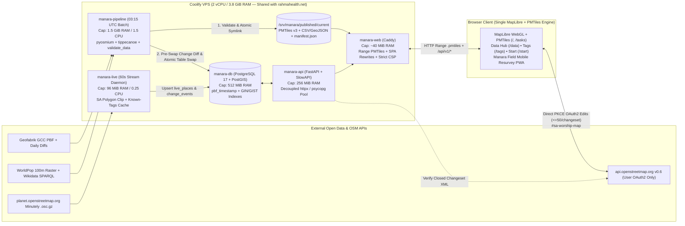

# Manara (`manara.saudiosm.org`) — Comprehensive Engineering & Product Improvement Plan

> *"Give me six hours to chop down a tree, and I will spend the first four sharpening the axe."* — Abraham Lincoln

**Baseline Audited**: Commit `be5f7c2` (`main`, 2026-10-31)
**Audit Scope**: Every file across `backend/` (FastAPI, PostgreSQL/PostGIS schema, auth, Arabic/transliteration engines, all 15 routers, SSR templates), `pipeline/` (all 21 geospatial, ML, replication, overlay, data-hub, and DB loader scripts), `frontend/` (all 10 HTML entry points, all 38 JS modules including 3,500-line `app.js`, all 9 CSS files including 4,676-line `index.css`, Vite/Playwright configs), `content/` (4 guides, 11 tag YAMLs), `deploy/` & Dockerfiles, `.github/workflows/ci.yml`, and all 31 test suites (152 `pytest` + 138 `vitest` passing).

---

## Table of Contents

1. [Executive Summary & Architectural Diagnosis](#1-executive-summary--architectural-diagnosis)
2. [Non-Negotiable Infrastructure & Policy Guardrails](#2-non-negotiable-infrastructure--policy-guardrails)
3. [Phase 0 — Emergency Hotfixes: Security, Data Corruption & Broken User Journeys (Days 1–3)](#3-phase-0--emergency-hotfixes-security-data-corruption--broken-user-journeys-days-13)
4. [Phase 1 — Wire Core Subsystems, DB Lifecycle & Vector-First Map Architecture (Weeks 1–2)](#4-phase-1--wire-core-subsystems-db-lifecycle--vector-first-map-architecture-weeks-12)
5. [Phase 2 — Geospatial Science, Data Quality & Arabic NLP Excellence (Weeks 3–4)](#5-phase-2--geospatial-science-data-quality--arabic-nlp-excellence-weeks-34)
6. [Phase 3 — Mapper UX, Mobile/RTL Polish, Accessibility & Civic Field Surveying (Weeks 5–7)](#6-phase-3--mapper-ux-mobilertl-polish-accessibility--civic-field-surveying-weeks-57)
7. [Phase 4 — CI/CD Hardening, Real PostGIS Testing, Repo Hygiene & Ops Resilience (Week 8)](#7-phase-4--cicd-hardening-real-postgis-testing-repo-hygiene--ops-resilience-week-8)
8. [Target Steady-State Architecture & Master Execution Matrix](#8-target-steady-state-architecture--master-execution-matrix)

---

## Progress Status (updated 2026-11-04) — READ THIS FIRST

The evidence line numbers below describe the `be5f7c2` audit baseline; the repo has moved since. **Verify an item against the current code before acting on it.**

**Phase 0 is done except for the leftovers listed here.** Verified at hand-off: `python -m pytest tests -q` (170 pass), and in `frontend/`: `npx vitest run` (146 pass), `npx eslint src`, `npx vite build` (all clean). The Playwright smoke tests (`npm run smoke`, about 7 minutes) were **not** run for this batch: run them before deploying.

| ID | Status | Notes |
| :--- | :--- | :--- |
| P0.1 SQLi in `/issues` | Done (before this session) | `RuleId` Literal + bind params; test exists |
| P0.2 rate limit/CSRF/cookies/XML | Done (before this session) | Leftover: `img-src` CSP for OSM/Gravatar avatars (consider initials badges) |
| P0.3 JSON-LD + `/start` | Done (before this session) | |
| P0.4 `/qa` + `/changes` 404s | Done (before this session) | Caddy + Vite rewrites exist |
| P0.5 pipeline/data hub | Done | Overlays run before data hub; no `.pmtiles.br/.gz`; CSV id/osm_type/name_norm filled; gaps JSON labelled `json`; atomic writes. **Not done:** root `Dockerfile` fallback for `*.pmtiles`/`manifest.json`/`by-region/` (they are gitignored, so a COPY would break clean builds: needs a build-arg or CI step), genuine RFC 7946 `worship_gaps_sa.geojson` export |
| P0.6 `tag_stats.py` | Done | Raw-tag stats; `psycopg` v3 + `MANARA_DATABASE_URL`; delete+insert per version. `UNIQUE NULLS NOT DISTINCT` only applies to newly created DBs (needs a migration for existing ones, see P4.3). Stats become correct only after the next pipeline run (new `*_original` props) |
| P0.7 edit flow | Mostly done | Done: `addNode` close-then-report, mark-before-report, repeat-report rebinding, `poi_node_id` binding, `verified_changeset` reset, OAuth redirect pinned to `/` with `osm_oauth_return_to`, same-element batch coalescing, 409 -> `conflict`, no `building=*` on nodes, Focus Mode `building_yes` goes through the dialog. **Not done:** per-item "Re-fetch & Retry" UI in `openBatchDialog`; `/api/v1/me` re-POST of `/auth/session` on cookie expiry; dev-token vs prod leaderboard guard (`routers/auth.py:22`); `outdated_tags` on merged features still edits only one element (`editing.js` `target`); sprint-tile binding in `edits.py` |
| P0.8 sprints/palette | Mostly done | Done: ISO codes (`SA-01..12,14`) in `sprints.py` + `palette.js`; PostGIS-clipped non-empty tiles with immediate workload (`workload_tiles_for_area`); invalidated re-lock; non-active sprint blocks tile actions; atomic `expire_stale_locks`; ETag `W/"{id}:{count}:{sum_rev}:{pending}"`; palette selectors; `osmTypeOf`; shortcut guards + `shortcutKey`; demo only with `?demo=1`. **Not done:** `grid_deg` auto-scaling; `tasks.js` CARTO tiles without attribution/key; regional sprint creation was only unit-tested with mocks (never run against real PostGIS: **test it on a real DB**) |

**Next up (plan order):** P1.1 `pbf_timestamp` cutoff + atomic static-before-DB publish, P1.2 unify the 13 QA rules, P1.3 wire `detect_changes.py`, P1.4 `manara-live`, P1.5 DB pool/search/leaderboard, P1.6 vector-first map.

**Housekeeping:** `design prompt.md` and `handover.md` are scratch files: keep them out of commits. The user allows pushing straight to `main` (auto-deploys via Coolify), so run the smoke tests first.

---

## 1. Executive Summary & Architectural Diagnosis

### 1.1 What Is Already Built (Do Not Re-Plan)
Through Redesign Phases 1–5 (`REDESIGN.md`, `HANDOFF.md`, `NEXT_LEVEL_ROADMAP.md`), Manara has grown from a single-page Leaflet viewer into a bilingual (Arabic RTL / English LTR) civic OSM platform for **14,022 places of worship across Saudi Arabia's 13 administrative provinces**:
- **10 Vite MPA pages** (`/`, `/mapgl`, `/tasks`, `/data`, `/tags`, `/guides`, `/start`, `/community`, `/about`, `/privacy`) plus FastAPI SSR SEO endpoints (`/place/{type}/{id}`, `/region/{code}`, `/sitemap.xml`).
- **15 FastAPI routers** backed by PostgreSQL 17 + PostGIS (`places`, `gaps`, `regions`, `issues`, `suggestions`, `change_events`, `sprints`, `sprint_tiles`, `review_marks`, `edits`, `users`, `sessions`, `region_stats_history`, `tag_stats_history`).
- **13 client/server QA rules**, direct browser-to-OSM OAuth2 PKCE editing (`#sa-worship-map`), Focus Mode triage, keyboard Command Palette (`Ctrl+K`), GASGI/UNGEGN Arabic-to-English transliteration, Isolation Forest geometry anomaly detection, K-Means mosque size classification, and 54,503 Wikidata suggestions.

### 1.2 Overarching Diagnosis
Manara's **feature surface area is impressive, but rapid multi-phase delivery left severe last-mile wiring, security, and data-contract bugs between layers**. Specifically:

1. **Critical Security & Auth Flaws**: An unauthenticated SQL injection exists in `GET /api/v1/issues`; `SlowAPIMiddleware` was never mounted (leaving 14 of 15 routers unthrottled while login collapses all global users behind Caddy's single Docker IP); SSR `<script type="application/ld+json">` templates lack `| tojson`; and `/start` has DOM XSS alongside an active `write_api` bearer token in `localStorage`.
2. **Broken User Journeys & Silent Fake Successes**:
   - `/start` calls 4 non-existent `OsmApi` methods, catches the `TypeError`, and **displays a fake *"Your edit was published successfully to OpenStreetMap!"* celebration while uploading nothing**—and its offline fallback hardcodes fake `osm_id`s (`12345678`, `87654321`) that would vandalize real OSM objects once upload is fixed.
   - **7 pages link to `/qa` and `/changes`**, which do not exist as HTML pages or Caddy rewrites and return **HTTP 404**.
   - **100% of regional Sprints fail creation with HTTP 400** (`> 2,000 tiles`), while 9 of 13 ISO 3166-2:SA province codes are scrambled in `sprints.py` and `palette.js`.
3. **Unwired Subsystems & Corrupt Published Metadata**:
   - Both `pipeline/live_replicator.py` and `pipeline/detect_changes.py` have **no `main()` entrypoints and are never invoked**—leaving `/api/v1/changes` permanently empty and `/api/healthz/live` permanently `503`.
   - `pipeline/run.py` runs `build_data_hub.py` *before* `build_overlays.py`, omitting all `.pmtiles` from `manifest.json`, and then precompresses `.pmtiles` into `.br`/`.gz` while Caddy forces `Content-Encoding: identity`, serving corrupt `.pmtiles` downloads.
   - `pipeline/tag_stats.py` measures synthetic fallbacks (`"Mosque"`, `"unknown"`), reporting **100.0% `name:en` coverage** on `/tags` when actual OSM coverage is **6.9%** (968 / 14,022), and silently fails DB history persistence by importing uninstalled `psycopg2`.
4. **Incomplete MapLibre Migration ("Quadruple-Map Debt")**:
   - Commit `f8f68c3` flipped `/` to MapLibre via `kit_gl.js`, **but `kit_gl.js` loads zero PMTiles**. `/` still blocks startup on downloading **6.7 MB** of raw GeoJSON + 4 JSON files (and **11.4 MB** on Wikidata toggle), converts 14,022 features to JS objects and back to GeoJSON in RAM, and paints gap pixels on the CPU on every pan—while maintaining 4 separate map setups across MapLibre and Leaflet.

### 1.3 Audit Scorecard

| Dimension | Current Grade | Target Grade | Primary Bottlenecks Identified |
| :--- | :---: | :---: | :--- |
| **Security & Privacy** | **D** | **A** | SQLi in `issues.py:114`; dead `slowapi` + proxy IP collapse; JSON-LD & `/start` XSS; incomplete PII erasure on `DELETE /api/v1/me` |
| **Data & Stats Integrity** | **D+** | **A** | `tag_stats.py` 100% fallback inflation; unnamed `"Mosque"` QA/SEO inversion; empty CSV columns; corrupt `.pmtiles.br`; `pbf_timestamp` wipe bug |
| **Subsystem Wiring** | **C-** | **A** | `live_replicator.py` & `detect_changes.py` dead code; `/qa` & `/changes` 404s; broken `/start` upload; broken `addNode` / `applyEdits` verification |
| **Frontend & Map Perf** | **C** | **A** | `kit_gl.js` ignores PMTiles (6.7 MB + 11.4 MB GeoJSON); 4 map setups; 3,500-line `app.js`; batch self-conflicts; broken mobile sidebar & i18n drift |
| **Geospatial & Arabic NLP** | **B-** | **A** | Zero population data in gap model; `cos(24°)` distortion; multipolygons & merged-node tags dropped; Python vs JS transliteration & guide drift |
| **CI/CD & Ops Resilience** | **C+** | **A** | Mocked SQL tests (no PostGIS in CI); copy-pasted JS unit tests; 26.5 MB generated data tracked in Git; no DB migrations or off-VPS backups |

---

## 2. Non-Negotiable Infrastructure & Policy Guardrails

Every recommendation in this plan strictly obeys the production hardware and OpenStreetMap governance boundaries established in `VPS_HARDWARE_ANALYSIS.md`, `REDESIGN.md`, and `HANDOFF.md`:

### 2.1 Production VPS Hardware Budget (`manara.saudiosm.org`)
- **Host**: 2 vCPU (AMD EPYC Genoa), **3.8 GiB total RAM** (~2.2 GiB free), 34 GiB free NVMe, shared with live production `rahmahealth.net` under Coolify 4.5 + Traefik.
- **Hard Container Caps**:
  - `manara-web` (Caddy static + reverse proxy): **~40 MiB RAM**
  - `manara-api` (FastAPI, 1 uvicorn worker, `psycopg` pool `max_size=10`): **256 MiB RAM**
  - `manara-db` (PostgreSQL 17 + PostGIS 3.5, `shared_buffers=128MB`): **512 MiB RAM**
  - `manara-live` (Minutely `.osc.gz` streaming replicator daemon): **96 MiB RAM / 0.25 CPU**
  - `manara-pipeline` (Daily batch job at 03:15 UTC, `n_jobs=1`, `NICE=19`): **1.5 GiB peak RAM / 1.5 CPU**
- **Prohibited on VPS**: No Node.js SSR server, no Nominatim/Overpass/tile-rendering daemon, no browser-automation containers, no multi-process `joblib(n_jobs=-1)` bursts that starve `rahmahealth.net`.

### 2.2 OpenStreetMap, Data Licensing & Privacy Compliance
1. **Zero Bulk Reads Against `api.openstreetmap.org`**: Bulk extraction uses Geofabrik GCC `.osm.pbf` + `pyosmium-up-to-date` daily diffs; live change tracking uses `planet.openstreetmap.org/replication/minute` `.osc.gz` streams (with `User-Agent: Manara/1.0 (https://manara.saudiosm.org; contact@saudiosm.org)` and >= 60s polling interval).
2. **Zero `tile.openstreetmap.org` Usage**: Base maps use Esri World Imagery, CARTO (only when a valid key is configured), or self-hosted/compliant vector styles.
3. **Human-Reviewed Edits Only**: Every OSM API v0.6 write uses the mapper's own OAuth2 token, previews the exact tag diff, enforces <= 50 objects per changeset, sets `hashtags=#sa-worship-map`, and respects OSM's Automated Edits Code of Conduct (no blind 1-key geometry/building retagging without visual verification).
4. **Contributor Privacy & ODbL**: Strip `user` and `uid` from all public files and `change_events` (retaining `changeset` and `timestamp`); lazy-fetch contributor metadata per object in the browser only for authenticated mappers (`sessionStorage`); provide complete PII erasure across all DB tables on `DELETE /api/v1/me`.

---

## 3. Phase 0 — Emergency Hotfixes: Security, Data Corruption & Broken User Journeys (Days 1–3)

> **Goal**: Close active security vulnerabilities, stop serving corrupt files/false statistics, and repair broken user flows (`/start`, `/qa`, `/changes`, `/tasks`, direct edit verification) before adding any new features.

### P0.1 Eliminate Unauthenticated SQL Injection in `GET /api/v1/issues`
- **Evidence**: `backend/app/routers/issues.py:27, 112-118, 155` accepts arbitrary `rule_id: str | None = Query(None)`. When the `issues` table is empty (fresh deployment or fallback branch), lines 112–118 construct `assigned_rule = rule_id or "missing_denom"` and interpolate it directly via f-string into raw SQL: `SELECT '{assigned_rule}' AS rule_id` executed on an `autocommit=True` connection.
- **Fix**:
  1. Validate `rule_id` at the FastAPI boundary against an explicit `Literal` / `KNOWN_RULE_IDS` frozenset covering all 13 canonical QA rules (returning HTTP `422` on unknown rule IDs).
  2. Replace the f-string literal in `issues.py:114` with a `psycopg` `%s` bind parameter (`SELECT %s::text AS rule_id`) and parameterize every branch of the fallback query.
- **Verification**: Add `test_issues_rejects_sql_injection_payload()` testing `GET /api/v1/issues?rule_id=';DROP TABLE places;--` against both populated and empty `issues` tables.

### P0.2 Fix Rate Limiting, Single-IP Proxy Collapse, CSRF, Session Cookies & XML Safety
- **Evidence**:
  - `backend/app/main.py:28, 54`: `limiter = Limiter(..., default_limits=["120/minute"])` is attached to `app.state.limiter`, **but `SlowAPIMiddleware` is never added**—leaving 14 of 15 routers completely unthrottled (including `POST /api/v1/edits`, `PUT /api/v1/marks`, `GET /api/v1/search`, and `POST /api/v1/transliterate`, which also lacks `max_length` on `TransliterateRequest.name` at `routers/transliterate.py:10`, allowing multi-megabyte regex CPU DoS).
  - `backend/app/routers/auth.py:25, 68`: Instantiates a **second disconnected `Limiter`** and `backend/Dockerfile:15` runs `uvicorn` without `--proxy-headers`, so `get_remote_address` sees Caddy's internal Docker IP—putting **every user worldwide into one shared `10/minute` login bucket**.
  - `backend/app/routers/changes.py:131`: `POST /api/v1/changes/{change_id}/triage` is missing `Depends(verify_csrf)`.
  - `backend/app/auth.py:90-110, 163-169`: `verify_csrf` skips origin validation if both `Origin` and `Referer` headers are absent; `get_session_token` accepts `manara_session` (`SESSION_COOKIE_DEV`) even on HTTPS (allowing sibling-subdomain `*.saudiosm.org` cookie fixation); `require_admin` trusts stale `users.is_admin` cached at login instead of checking `get_admin_uids()` dynamically.
  - `backend/app/routers/edits.py:117-130`: Buffers arbitrary-size changeset XML into RAM and parses with stdlib `xml.etree.ElementTree` instead of `defusedxml` + streaming byte cap.
  - `deploy/Caddyfile.container:31`: `img-src 'self' data: blob:` + Esri/CARTO blocks OSM/Gravatar user profile avatars returned by `/api/v1/me`.
- **Fix**:
  1. Export a single shared `limiter` module (`backend/app/limiter.py`), mount `app.add_middleware(SlowAPIMiddleware)` in `main.py`, pass `--proxy-headers --forwarded-allow-ips=<docker-subnet>` to `uvicorn` in `backend/Dockerfile:15`, and add explicit per-route limits (`10/minute` on `/auth/session`, `30/minute` on `POST /api/v1/edits` and `POST /api/v1/transliterate`, `60/minute` on `PUT /api/v1/marks` and sprint tile mutations).
  2. Enforce `Field(..., min_length=1, max_length=200)` on `TransliterateRequest.name` (`routers/transliterate.py:10`).
  3. Add `Depends(verify_csrf)` to `triage_change` (`routers/changes.py:131`) and require `X-Manara-CSRF: 1` **plus** valid `Origin` when `Origin` is present (rejecting cross-origin `Origin` unconditionally).
  4. Only read `SESSION_COOKIE_DEV` when `request.url.scheme == "http"` and `settings.dev_mode` is enabled; re-evaluate `user["osm_uid"] in get_admin_uids()` inside `require_admin` and `/api/v1/me`.
  5. Stream `httpx` responses in `edits.py` with a 2 MiB max byte guard and parse XML via `defusedxml.ElementTree.fromstring`.
  6. Update `Caddyfile.container` `img-src` (or proxy/omit external avatar `` tags in favor of initials badges if strict zero-third-party-request privacy is preferred—recommended: **render SVG initials badges by default** so browsing never leaks visitor IPs to Gravatar/OSM servers).

### P0.3 Fix SSR JSON-LD Injection & Overhaul `/start` Beginner Onboarding
- **Evidence**:
  - `backend/app/templates/place.html:12-32` and `region.html:8-26` interpolate `"{{ place.name }}"` inside `<script type="application/ld+json">`. Jinja2 HTML-auto-escapes quotes (`&#34;` / `&#39;`, breaking JSON parsers) while leaving backslashes and control characters unescaped.
  - `frontend/src/start.js` has **six compounding bugs**:
    1. `start.js:68`: Calls `OsmApi.startOAuthFlow()` (does not exist; real method is `OsmApi.startLogin()`).
    2. `start.js:229, 231`: Calls `OsmApi.createChangeset()` and `OsmApi.updateElement()` (neither exists; real method is `OsmApi.applyEdits()`).
    3. `start.js:237-241`: Catches the resulting `TypeError` and **calls `showSuccessState(finalNameEn, arName)` anyway**, deceiving mappers into thinking their edit went live on OSM.
    4. `start.js:100-127`: Falls back to hardcoded fake `osm_id: 12345678` (`way/12345678`) and `87654321` (`node/87654321`)—which **would overwrite real unrelated OSM objects worldwide** the instant `OsmApi.applyEdits()` is wired!
    5. `start.js:160-193`: Injects `${arName}`, `${city}`, and `value="${suggestedEn}"` into `innerHTML` without escaping (DOM XSS with `localStorage.osm_access_token` exposed), omits `#sa-worship-map` from changeset hashtags (`line 228`), ignores `Relation` and `poi_node_id` (`line 230`), and downloads the entire **6.7 MB** `places_of_worship_sa.geojson` (`line 81`).
    6. `frontend/start.html:100` links to `/tags#tag-name_en`, which `frontend/src/tags.js:388` prefixes a second time into `#tag-tag-name_en` (broken anchor scroll).
- **Fix**:
  1. Serialize the entire JSON-LD dictionary in Python (`json.dumps(..., ensure_ascii=False).replace("</", "<\\/")`) or use Jinja's `| tojson` filter on the dict object in `place.html` and `region.html`.
  2. Rewrite `frontend/src/start.js` to:
     - Fetch `GET /api/v1/issues?rule_id=missing_name_en&limit=50` (~15 KB JSON instead of 6.7 MB GeoJSON), and if offline/unavailable, render an explicit **read-only practice sandbox badge** with Save-to-OSM disabled—**deleting fake OSM IDs `12345678` and `87654321` permanently**.
     - Build card DOM via `textContent` / `.value` (or `escapeHtml`), never raw `innerHTML`.
     - Use `OsmApi.startLogin()` (with `return_to=/start` in `sessionStorage`), `OsmApi.applyEdits([{ type: targetType, id: targetId, expectedVersion, edits: { set: { 'name:en': finalNameEn } }, label: arName }], { comment, source: 'translating' })` (which automatically sets `hashtags=#sa-worship-map`, closes the changeset in `finally`, and reports to `/api/v1/edits`), and surface real errors via `showToast(..., 'error')` instead of faking success.
  3. Normalize hash stripping in `tags.js:388` (`rawHash.replace(/^(#tag-)+/, '')`).

### P0.4 Fix HTTP 404 `/qa` and `/changes` Navigation Links Across All 7 Pages
- **Evidence**: `#qa-workspace` and `#changes-workspace` are overlays inside `frontend/index.html:1132, 1250`, not standalone HTML files. Yet `mapgl.html:15`, `tasks.html:15-16`, `data.html:15-16`, `tags.html:15-16`, `tags.js:207` (`/qa?rule=...`), `guides.html:17`, `start.html:17, 104`, and `start.js:141` all link to `/qa` and `/changes`, returning **HTTP 404** in Vite and Caddy (`deploy/Caddyfile.container:59, 98`).
- **Fix**:
  1. Add clean URL rewrites in both `deploy/Caddyfile.container` and `frontend/vite.config.js` so `/qa` and `/changes` serve `index.html` with HTTP 200.
  2. Extend `Permalink.apply()` (`frontend/src/review.js:306-342`) and `app.js` boot initialization to detect `pathname === '/qa'` (or `?workspace=qa`) and `pathname === '/changes'` (or `?workspace=changes`), automatically activating `#qa-workspace` (pre-selecting `?rule=<id>` and `?region=<code>` when passed from `/tags`!) or `#changes-workspace`, and updating `history.replaceState` when switching topbar workspace tabs.

### P0.5 Fix `.pmtiles` Omission from `manifest.json`, Corrupt `.pmtiles.br` Downloads, Empty CSV Columns & Docker Fallback
- **Evidence**:
  - `pipeline/run.py:77-78` runs `build_data_hub.py` **before** `build_overlays.py` in a freshly wiped `WORK_DIR`, so `manifest.json` omits `places.pmtiles`, `gaps.pmtiles`, and `suggestions.pmtiles` on every clean daily run; `frontend/data.html:75-79` also omits `<option value="pmtiles">`.
  - `pipeline/run.py:100-103, 244-266` precompresses `.pmtiles` into `.pmtiles.br` and `.pmtiles.gz` (wasting 20+ minutes of Brotli-11 CPU on already gzip-compressed internal MVT tiles), while `deploy/Caddyfile.container:82-88` sets `header /data/*.pmtiles Content-Encoding identity` alongside `file_server { precompressed br gzip }`—causing Caddy to serve raw Brotli bytes labeled `Content-Encoding: identity` on full `.pmtiles` downloads!
  - `pipeline/build_data_hub.py:41-63` reads `feat.get("id")`, `props.get("osm_type")`, and `props.get("name_norm")`—writing **100% empty strings** for all 3 columns across national and regional CSVs (`extract_places.py` stores `props["id"]` and `props["geom_type"]`), and lines `337, 502` label non-GeoJSON custom grid files `worship_gaps_*.json` as `"format": "geojson"` (crashing QGIS/GDAL).
  - Root `Dockerfile:29-39` omits `*.pmtiles`, `manifest.json`, and `by-region/` from `/srv/manara/data/` fallback.
- **Fix**:
  1. Swap step order in `pipeline/run.py:77-78` so `build_overlays.py` runs **before** `build_data_hub.py`.
  2. Exclude `.pmtiles` from `precompress()` in `pipeline/run.py:249` (delete any stale `*.pmtiles.br`/`*.pmtiles.gz` during publish) and disable `precompressed` lookup on `/data/*.pmtiles` in `Caddyfile.container`.
  3. Add `<option value="pmtiles">PMTiles</option>` to `frontend/data.html:75-79`.
  4. Fix `write_places_csv_features()` in `build_data_hub.py:41-63` to read `props.get("id")`, `props.get("geom_type")`, and `normalize_arabic(props.get("name_original", ""))`; label `worship_gaps_*.json` as `"format": "json"` (and export a genuine RFC 7946 `worship_gaps_sa.geojson` for GIS users); switch all `open(..., "w")` calls in `build_data_hub.py` to atomic `common.write_json()`.

### P0.6 Fix `tag_stats.py` 100% Synthetic Fallback Inflation & Broken `psycopg2` DB Writer
- **Evidence**:
  - `pipeline/tag_stats.py:57-76` (`props_to_tags`) reads synthetic post-fallback GeoJSON fields (`name="Mosque"`, `name_en=name`, `denomination="unknown"`), causing `/tags` (`tag_stats_sa.json` / `tags.json`) to claim **100.0% coverage** (`14,022 / 14,022`) for `name:en` (true OSM value: **6.9% / 968**), `name`, `denomination`, and `religion`, while mapping OSM `name` (`name_original`) onto `name:ar`, leaking internal props (`duplicate_poi`, `region_code`) into co-occurrence tables, and reporting `0.0%` for `opening_hours` (dropped in `extract_places.py`).
  - `pipeline/tag_stats.py:196, 201` checks `MANARA_DB_URL` (wrong env var; app uses `MANARA_DATABASE_URL`) and runs `import psycopg2` (not installed; repo uses `psycopg` v3), silently swallowing `ModuleNotFoundError` so `tag_stats_history` is permanently empty!
- **Fix**:
  1. Preserve `opening_hours` in `extract_places.py` and compute `tag_stats.py` strictly from raw OSM tag presence (`name_original`, `name_ar_original`, `name_en_original`, raw `denomination != "unknown"`, raw `religion != "unknown"`, excluding `SKIP_PROPS` internal keys)—or scan worship features directly via `pyosmium` in 3 seconds.
  2. Migrate `record_stats_to_db()` (`tag_stats.py:194-256`) to `psycopg` v3 + `MANARA_DATABASE_URL`, and add `UNIQUE NULLS NOT DISTINCT (dataset_version, tag_key, tag_value)` in `backend/app/schema.py:157`.

### P0.7 Fix OSM Edit Verification Race Conditions, OAuth Callback Failures, Batch Self-Conflicts & Invalid Node Tagging
- **Evidence**:
  1. **`addNode` always fails `/api/v1/edits` verification (`osm_api.js:392 vs 409`)**: `addNode` calls `this.reportEdit(changesetId)` *before* `finally` calls `closeChangeset(changesetId)`, so `backend/app/routers/edits.py:99` rejects every newly added mosque with HTTP 400 (`Changeset is still open`).
  2. **`applyEdits` races `ReviewMarks.set` & drops merged `poi_node_id` bindings (`osm_api.js:461`, `editing.js:534, 738`, `edits.py:59-68, 155-169`, `reviews.py:119-123`)**: `reportEdit` fires un-awaited *before* `ReviewMarks.set` inserts the `review_marks` row; `edits.py:59-68` returns early without re-binding marks on duplicate reports; `poi_node_id` edits record `("node", poi_node_id)` while `review_marks` keys `("way", building_way_id)`; and `reviews.py:119-123` retains stale `verified_changeset` on mark updates.
  3. **OAuth broken on `/tasks` & session desync (`osm_api.js:60-64, 176-217`, `tasks.js:131`, `routers/auth.py:22`)**: `OsmApi.redirectUri()` uses `window.location.pathname`, sending un-registered `https://manara.saudiosm.org/tasks/` to OSM OAuth2; `tasks.js` never runs `handleCallback()`; non-expiring `localStorage.osm_access_token` outlives the 30-day backend session cookie without refreshing `/auth/session`; and `routers/auth.py:22` hardcodes prod OSM URL even for `dev` tokens.
  4. **Batch self-conflict & trapped conflict queue (`editing.js:601, 642-781`, `osm_api.js:256, 433`)**: Queuing two fixes on the same mosque (e.g., `missing_name_en` + `missing_denom`) snapshots the same `expectedVersion` twice; fix #1 bumps OSM's version and causes fix #2 to self-conflict 120ms later, while `openBatchDialog` offers zero UI to refresh/resolve conflicts and `_request()` misclassifies mid-flight `PUT` HTTP 409 as `'error'` instead of `'conflict'`.
  5. **Invalid `building=mosque` on `<node>` & blind 1-key building retagging (`presets.js:43-45, 61`, `app.js:3227, 3355`, `focus_mode.js:384-409`, `editing.js:114-128`)**: `#add-mosque-overlay` offers the area-only `building=mosque` checkbox when creating a point `<node>` (immediately triggering `mapped_as_node`!); Focus Mode `Space`/`F` queues `building=yes -> building=mosque` in 1 keypress without tag diff or satellite confirmation; and `editing.js:116` guesses `'poi'` on merged building+node features without checking which element actually carries the outdated tag.
- **Fix**:
  1. Move `await this.reportEdit(changesetId)` *after* `closeChangeset` in `addNode`, and execute `await ReviewMarks.set(...)` *before* `await OsmApi.reportEdit(changesetId)` in `editing.js`; in `edits.py`, re-run mark & sprint-tile binding even if `changeset_id` already exists, join `places.poi_node_id` so node edits bind to their parent merged way's `review_mark`, and clear `verified_changeset = NULL` when `osm_version` or `status` changes in `reviews.py`.
  2. Pin `OsmApi.redirectUri()` to `window.location.origin + '/'`, persist `sessionStorage.osm_return_to = location.pathname + location.search + location.hash` across login, verify `GET /api/v1/me` inside `OsmApi.checkAuth()` (re-POSTing `/auth/session` automatically when the cookie expires), and pass `environment: 'prod' | 'dev'` cleanly (blocking `dev` tokens from mutating prod leaderboard stats).
  3. Coalesce multiple `EditBatch` fixes on the same `(type, id)` into a single merged `edits` object in `EditBatch.add()` (one `GET` + one `PUT` per element!), detect HTTP 409 in `_request()`, and add **"Re-fetch latest tags & Retry"** / **"Remove"** controls per conflicted item in `openBatchDialog`.
  4. Filter preset fields by geometry (`geometry: ['area']` on `building=mosque` so `#add-mosque-overlay` never puts `building=*` on a `<node>`), require explicit diff confirmation + satellite imagery active before queuing `building=yes -> building=mosque` in Focus Mode, and fetch both `way` and `poi_node_id` XML when resolving `outdated_tags` on merged features.

### P0.8 Fix Sprints (`/tasks`) & Command Palette ISO 3166-2:SA Codes, >2,000 Tile Rejection & State Machine
- **Evidence**:
  - **Scrambled ISO 3166-2:SA codes**: Both `backend/app/routers/sprints.py:18-32` and `frontend/src/palette.js:6-20` scramble `SA-05` through `SA-13` (inventing `SA-13` and omitting `SA-14` Asir) relative to real ISO/OSM codes in `extract_regions.py` (`SA-05`=Al-Qassim, `SA-06`=Ha'il, `SA-08`=Northern Borders, `SA-09`=Jazan, `SA-10`=Najran, `SA-11`=Al-Bahah, `SA-12`=Al-Jawf, `SA-14`=Asir).
  - **100% of regional sprints fail creation (`sprints.py:263-268`)**: Every entry in `REGION_BOUNDS` produces `2,601` to `236,250` `0.02°` bbox tiles, exceeding `MAX_SPRINT_TILES = 2000` with HTTP 400! Polygon sprints also tile the full bounding rectangle instead of clipping to the polygon, and `create_sprint` leaves all tiles at `workload = 0` until tomorrow's pipeline run (`line 315`).
  - **State-machine, ETag & UI bugs**: `invalidated` tiles can never be re-locked (`sprints.py:547-561` rejects `state == "invalidated"`); `ETag: W/"{rev_max}"` (`line 445`) collides across tiles (`max(rev)` stays `2` while other tiles advance `1 -> 2`, serving stale `304`); `draft`/`closed` sprint status is unchecked on `PUT` (`line 519`); `expire_stale_locks` mutates DB on `GET` without `FOR UPDATE` (`lines 403-417`); `tasks.js:924-958` lacks `e.ctrlKey || e.metaKey || e.altKey` guards (hijacking `Ctrl+A` / `Ctrl+L`!) and Arabic layout `shortcutKey(e)`; `tasks.js:226` loads unauthenticated CARTO tiles without attribution; `tasks.js:338-359` injects a fake production demo sprint (`al-kharj-mosques-2026`); and `app.js:270, 1107-1117` has 3 broken Command Palette DOM selectors (`toggle_satellite`, `toggle_qibla`, `toggle_wikidata`) plus `osmTypeOf(props)` ignoring `props.osm_type`.
- **Fix**:
  1. Replace hardcoded `REGION_BOUNDS` in `sprints.py` with live `regions` table geometry from PostGIS (`SA-01`..`SA-12`, `SA-14`), clip generated grid cells with `ST_Intersects(sprint_geom, cell_geom)`, compute initial `workload` immediately inside `create_sprint`, and **persist only non-empty workload cells** (or auto-scale `grid_deg` from `0.02°` to `0.05°`/`0.1°` for province-wide campaigns so empty desert cells never blow `MAX_SPRINT_TILES`).
  2. Allow `lock` from `state IN ('ready', 'invalidated')`, block tile actions when `sprint.status != 'active'`, wrap `expire_stale_locks` in an atomic `UPDATE ... WHERE state IN ('mapping','validating') AND locked_until < NOW() RETURNING ...` CTE, and change ETag to `W/"{sprint_id}:{count}:{sum_rev}:{pending_count}"`.
  3. Fix ISO codes in `palette.js:6-20`, fix the 3 DOM selectors in `app.js:1107-1117`, check `props.osm_type` first in `osmTypeOf()` (`app.js:270`), add modifier-key guards + `shortcutKey(e)` in `tasks.js:924`, and gate the fallback demo sprint in `tasks.js:338` strictly behind `?demo=1`.

---

## 4. Phase 1 — Wire Core Subsystems, DB Lifecycle & Vector-First Map Architecture (Weeks 1–2)

> **Goal**: Turn dead/stubbed subsystems (`detect_changes.py`, `live_replicator.py`, PMTiles on `/`) into reliable production engines, fix `pbf_timestamp` data-loss bugs, unify QA rules across all 4 layers, and eliminate backend DB pool bottlenecks.

### P1.1 Fix `pbf_timestamp` Cutoff Semantics & Atomic Static-Before-DB Publish
- **Evidence**:
  - `pipeline/load_db.py:508, 558-585` records `published_at = datetime.now(timezone.utc)` (around `03:20 UTC`) and clears `sprint_tiles.pending_refresh = FALSE` where `edits.verified_at < published_at`; `backend/app/routers/reviews.py:72` hides `'fixed'` marks older than `published_at`. Because Geofabrik's GCC PBF cutoff is typically `~20:00–21:00 UTC` the previous evening, **every verified OSM edit and review mark submitted in that 6–24 hour window is prematurely wiped before the PBF actually contains it**!
  - `pipeline/run.py:80` runs `load_db.py` *before* `publish()` swaps `/srv/manara/published/current`, creating a window where PostgreSQL serves new dataset metadata while Caddy serves yesterday's static GeoJSON/PMTiles.
- **Fix**:
  1. Extract the exact `osmosis_replication_timestamp` header from the PBF via `pyosmium` (or `osmium fileinfo`), store `pbf_timestamp TIMESTAMPTZ` in `dataset_meta` and `summary.json`, and compare `edits.verified_at < pbf_timestamp` and `review_marks.updated_at < pbf_timestamp` everywhere (`load_db.py`, `reviews.py`, `detect_changes.py`).
  2. Reorder `pipeline/run.py` so all static artifacts + `validate_data.py` succeed and stage atomically right alongside `load_db.py` (with `SET LOCAL lock_timeout = '5s'` and post-swap `ANALYZE places, gaps, regions, issues, suggestions`).

### P1.2 Unify All 13 QA Rules Across Pipeline, PostGIS, FastAPI, Frontend & `/sitemap.xml`
- **Evidence**:
  - `extract_places.py:132` assigns fallback `name = "Mosque"` to ~8,000 unnamed OSM mosques. `pipeline/load_db.py:354-360` omits `'mosque'` from `missing_name` (under-counting unnamed mosques by ~8,000!) and fails to exclude `'Mosque'` from `missing_name_en` (falsely telling mappers to add an English name to ~8,000 mosques that have **no Arabic name at all**!).
  - `backend/app/routers/seo.py:168` (`sitemap.xml`) excludes `('مسجد','جامع','مصلى')` in `WHERE`, forgetting `'Mosque'`—submitting ~8,000 URLs to Google that `/place/{type}/{id}` serves with `<meta name="robots" content="noindex">`!
  - `load_db.py` populates only **9 of 13** QA rules (omitting `mapped_as_node`, `duplicate_poi`, `stale_data`, `outdated_tags`), tests unreachable un-normalized `'مصلى'`/`'جامع'` against `name_norm` (where `ى -> ي`), and disagrees on thresholds with `validator.js` (`qibla_anomaly` `>30` vs `>=30`, `suspicious_size` `10..40000` vs `25..50000`, `incomplete_address` gating).
- **Fix**:
  1. Define a single declarative rule specification (`content/qa_rules.json` covering all **13 rules**, severities, weights, and exact thresholds) consumed by `extract_places.py`/`load_db.py`, `backend/app/routers/issues.py`, and `frontend/src/validator.js`.
  2. Key `missing_name` and `missing_name_en` strictly off `name_original` / `name_en_original` + `is_generic_mosque_name()`, and exclude `LOWER(TRIM(COALESCE(name_original, ''))) = ''` (and all generic names) in `seo.py:168`.

### P1.3 Wire Daily Change Detection (`detect_changes.py`) into the Pipeline
- **Evidence**: `pipeline/detect_changes.py` has no `main()` and is absent from `pipeline/run.py:STEPS`. If called *after* `load_db.py` swaps `places_next -> places`, `places` already equals the new PBF (producing 0 changes); its 48h `reverted_same_day` SQL (`lines 247-259`) falsely flags post-PBF-cutoff live edits as reverted; `schema.py:82` lacks `UNIQUE NULLS NOT DISTINCT` on `(source, osm_type, osm_id, osm_version, changeset)`; and 3 flags in `change_rules.py` (`left-boundary`, `new-duplicate`, `issue-fixed`) are never emitted.
- **Fix**:
  1. Invoke `detect_changes_from_prev_places(conn, new_places, pbf_timestamp)` **inside `load_db.py` right before the atomic `places_next -> places` table swap**, comparing `places_next` against current `places`.
  2. Guard `reverted_same_day` with `AND ce.created_at <= %(pbf_timestamp)s`.
  3. Add `UNIQUE NULLS NOT DISTINCT` on `change_events` (`schema.py:82`) and compute `moved-far` (>200m centroid shift), `left-boundary` (outside `sa_boundary`), `new-duplicate` (<30m to existing worship feature), and `issue-fixed` (drop in `issues` count for `(osm_type, osm_id)`).

### P1.4 Build & Deploy the `manara-live` Minutely OSM Replicator Daemon (96 MiB Cap)
- **Evidence**: `pipeline/live_replicator.py` is a 308-line library stub with no `main()`, HTTP loop, or backoff (`/api/healthz/live` returns permanent `503`). Furthermore:
  - `load_known_places` discards existing tags and passes `old_tags={}` (`line 274`), disabling 5 of 6 `flag_change` rules (`worship-removed`, `name-removed`, `wikidata-changed`, `denomination-changed`, `version-jump`).
  - `modify` events that strip worship tags from a known mosque are skipped (`line 180`), missing mosque vandalism/deletion-by-untagging!
  - Way edits without `<nd>` coordinate changes in the `.osc` diff and all multipolygon relations (whose members are `<member type="way">`) fail centroid lookup and drop silently.
  - `tag_diff` stores raw `tags` (`line 286`) instead of `{added, removed, changed}` from `compute_tag_diff()`, crashing `changes_view.js` diff rendering.
  - Coarse `SA_BBOX` (`34.5..55.7, 16.0..32.2`) ingests worship edits from Egypt, Jordan, Iraq, Kuwait, Bahrain, Qatar, UAE, Oman, Yemen, Sudan, and Eritrea with `region_code = NULL`!
- **Fix**:
  1. Implement `python -m pipeline.live_replicator` as a supervised lightweight daemon (`96 MiB` RAM cap, `0.25 CPU` in Coolify) polling `planet.openstreetmap.org/replication/minute/state.txt` every 60s with exponential backoff, custom `User-Agent`, and `live_state` persistence.
  2. Cache `(lon, lat, region_code, tags_json)` in `known_places` (loaded from `places` + `live_places` at startup ~6 MB RAM, updated incrementally on each sequence), check known IDs *before* `is_worship(tags)` so worship-tag stripping triggers `worship-removed`, and pass `compute_tag_diff(old_tags, new_tags)` into `change_events.tag_diff`.
  3. Filter candidate coordinates against prepared `sa_boundary.geojson` (`shapely.prepared.prep`) and assign `region_code` via spatial point-in-region lookup (eliminating all 11 neighboring countries!).
  4. Persist unresolved new ways/relations in `live_pending` and resolve centroids via throttled single-object `/api/0.6/{way|relation}/{id}/full.json` (capped at <= 10 lookups/minute, strictly compliant with OSM API policy).

### P1.5 Eliminate Backend DB Pool Starvation, Slow Full-Table Search & Leaderboard Cartesian Joins
- **Evidence**:
  - `backend/app/routers/edits.py:49` is `async def` executing synchronous `psycopg` queries on the main event loop while holding one of the 10 DB pool connections across external `httpx` calls to `api.openstreetmap.org` (up to 10s); `routers/auth.py:74` also acquires `Depends(get_db)` before awaiting `fetch_osm_user` (10s). Ten slow OSM responses exhaust `max_size=10` and freeze the entire API (`including /api/healthz`).
  - `backend/app/routers/search.py:37` runs `OR name_en ILIKE %s` with **no trigram index on `places.name_en`** (forcing a full scan on every keystroke), unescaped `%`/`_` wildcards, and `similarity(name_norm, q_norm)` only—scoring all English queries `0.0`!
  - `backend/app/routers/community_data.py:29-30` joins `users -> LEFT JOIN edits -> LEFT JOIN review_marks`, creating an `O(E × M)` Cartesian product per user and computing `COALESCE(MAX(e.verified_at), MAX(rm.updated_at))` instead of `GREATEST(...)`.
  - `frontend/src/community.js:554-585` (`getAggregatedKingdomSeries`) fetches `?limit=200` across 13 provinces (`200 % 13 = 5` rows on the oldest date!) and sums partial dates without asserting `regions.size === 13`, creating a false 60% drop cliff on the Kingdom trend chart!
  - `backend/app/schema.py` lacks `CREATE EXTENSION IF NOT EXISTS postgis;` and `pg_trgm;`.
- **Fix**:
  1. Perform outbound `httpx` OSM calls **before** acquiring a DB connection from `pool`, and run sync `psycopg` blocks in `def` endpoints or `run_in_threadpool`.
  2. Add `CREATE EXTENSION IF NOT EXISTS postgis, pg_trgm;` and missing indexes to `schema.py` / `load_db.py`:
     - `idx_places_name_en_trgm ON places USING GIN (LOWER(name_en) gin_trgm_ops)`
     - `idx_edits_verified_at ON edits (verified_at)` and `idx_edits_uid_verified ON edits (osm_uid, verified_at DESC)`
     - `idx_changes_flags_gin ON change_events USING GIN (flags)` and `idx_changes_region_created ON change_events (region_code, created_at DESC)`
     - `idx_region_history_code_date ON region_stats_history (region_code, recorded_at DESC)`
  3. Escape `ILIKE` `%`/`_` metacharacters in `search.py` and rank by `GREATEST(similarity(name_norm, q_norm), similarity(LOWER(name_en), LOWER(q)))`.
  4. Rewrite `/api/v1/leaderboard` using pre-aggregated CTEs (`edit_counts`, `mark_counts`, `tile_counts` grouped by `osm_uid`) + `GREATEST(...)`, and filter `getAggregatedKingdomSeries` in `community.js` to dates where `bucket.regions.size === 13` (raising Kingdom history limit to `13 * 90 = 1170` or adding `GET /api/v1/stats/history?region=ALL` SQL aggregation).

### P1.6 Deliver True Vector-First PMTiles Rendering on `/` & Collapse 4 Map Setups into 1
- **Evidence**:
  - Despite commit `f8f68c3` switching `/` to MapLibre (`kit_gl.js`), **`kit_gl.js` loads zero PMTiles**: `/` still downloads **6.7 MB** `places_of_worship_sa.geojson` + 4 JSONs before hiding `#loading-overlay` (plus **11.4 MB** `suggested_mosques_sa.geojson` on toggle), runs `main.js:12-13` sequentially (`await loadMapKit()` -> 1.08 MB MapLibre -> *then* `await import('./app.js')`), paints gap grids on the CPU (`GlGapLayer._draw`, `kit_gl.js:696-725`), and thrashes HTML DOM cluster markers on every pan (`kit_gl.js:458-499`).
  - Meanwhile, `/mapgl` (`map_gl_view.js`) is an orphaned feature-incomplete PMTiles prototype, `/?map=leaflet` keeps 200 KB of legacy Leaflet shims alive, `/tasks` imports Leaflet + unauthenticated CARTO tiles directly, `pipeline/Dockerfile:10` silently fails `apt-get install tippecanoe || true` (falling back to 26.8 MB unoptimized Python MVT tiles), and `frontend/package.json:19` carries unused `"astro": "^7.4.4"`.
- **Fix**:
  1. **Compile `tippecanoe` in a multi-stage `pipeline/Dockerfile` builder** (`git clone https://github.com/felt/tippecanoe` -> `COPY --from=tippecanoe-builder /usr/local/bin/tippecanoe`) and enrich `places.pmtiles` in `build_overlays.py` with compact integer/bitmask properties (`qa_mask`, `qa_count`, `size_tier`, `area_m2`, `qibla_dev`, `days_old`, `region_code`, `has_female`, `has_en`, `has_wikidata`) so `places.pmtiles` shrinks from ~14 MB to **~3–4 MB** while supporting instant client-side WebGL filtering!
  2. **Wire `pmtiles://` directly into MapLibre on `/`**:
     - Parallelize `Promise.all([loadMapKit(), import('./app.js'), fetch('/data/summary.json')])` in `main.js`.
     - Render `places.pmtiles`, `gaps.pmtiles`, and `suggestions.pmtiles` natively via MapLibre WebGL vector layers (eliminating the upfront **6.7 MB** + **11.4 MB** GeoJSON downloads, CPU `GlGapLayer` canvas loop, and DOM cluster marker thrashing).
     - Fetch full place details on click (`GET /api/v1/places/{type}/{id}` or tile properties) and power `#qa-workspace` / Focus Mode via paginated `/api/v1/issues` (with lazy background GeoJSON fallback only if the user triggers full offline GeoJSON export or API is unreachable).
  3. **Collapse 4 maps into 1 shared MapLibre engine**: Migrate `/tasks` sprint grid from Leaflet (`tasks.js:9, 209-285`) to MapLibre + Esri imagery/dark vector style, redirect `/mapgl` -> `/`, remove `kit_leaflet.js`, `leaflet-bundle.js`, `BoundaryCanvas.js`, and remove unused `astro` from `frontend/package.json`.

---

## 5. Phase 2 — Geospatial Science, Data Quality & Arabic NLP Excellence (Weeks 3–4)

> **Goal**: Elevate Manara's analytical credibility from heuristic bounding-box approximations to rigorous geospatial science and authoritative Saudi Arabic/English cartographic standards—within the 1.5 GiB daily batch pipeline cap.

### P2.1 Upgrade Worship Coverage Gap Model (`calculate_gaps.py` & `load_db.py`)
- **Evidence**:
  - `pipeline/calculate_gaps.py:130-198` uses **zero population data**, weights desert tracks (`highway=track`), industrial alleys (`highway=service`), and motorways at `1.0` (`EXCLUDED_HIGHWAYS` omits them), dumps an entire multi-kilometer road's length into the **single 440m cell of its vertex mean** (`lines 150-156`), uses fixed `cos(24°)` across `16°N–32°N` (+5.8% north / -7.4% south distance error), and skips residential buildings unless they carry `name=*`.
  - `pipeline/load_db.py:277-278` inserts `gaps.geom` at `(lon_sw, lat_sw)` (SW corner) instead of cell center `(lon_sw + grid_size/2, lat_sw + grid_size/2)` used by `build_overlays.py:124` and `build_data_hub.py:92`—**shifting every PostGIS gap cell ~310 meters southwest** relative to PMTiles and CSV exports and breaking sprint gap workload counts (`sprints.py:175`)!
- **Fix**:
  1. Fix `load_db.py:277-278` immediately to store cell centroids `(lon + half, lat + half)` (or `ST_MakeEnvelope` cell polygons).
  2. Integrate **WorldPop Saudi Arabia 100m Constrained Population GeoTIFF** (~15 MB static asset cached in `/srv/manara/cache/worldpop_sau_100m.tif`, streamed Window-by-Window via `rasterio` in < 80 MiB RAM) combined with **OSM residential building footprint counts** (`building IN ('residential','apartments','house','detached','yes')` inside `landuse=residential`).
  3. Exclude `track`, `service`, `motorway`, `motorway_link`, `trunk`, `raceway`, `bridleway`, `escape`, `bus_guideway`, and `corridor`; split road segments accurately across traversed `0.004°` grid cells; and use per-row `math.cos(math.radians(lat))` (or `EPSG:32637` / `EPSG:32638` metric projection).
  4. Re-formulate urgency transparently as an interpretable **Mosque Need Index (0–100)** combining *estimated resident population*, *residential building density*, and *walking-network/haversine distance to nearest worship place* (capped at Saudi urban walking thresholds: 400m neighborhood `مسجد`, 800m Friday `جامع`).

### P2.2 Fix Mosque Geometry, Area Distortion, Multipolygons, Merged-Node Tag Loss & Qibla Anomalies
- **Evidence**:
  - `pipeline/extract_places.py`:
    - Ignores multipolygon relations (`def area(self, a)` is missing—dropping courtyard mosques or emitting unclosed outer member ways as distorted `Polygon`s without inner courtyard subtraction!).
    - Uses `.contains(pt)` instead of `.covers(pt)` when merging POI nodes (`line 277`, missing boundary-snapped entrance nodes) and **only copies `name`, `denomination`, `religion`** (`lines 285-290`), **silently discarding `name:ar`, `name:en`, `female*`, `wikidata`, `opening_hours`, `wheelchair`, and `addr:*`** from the merged inner POI node!
  - `pipeline/calculate_mosque_sizes.py` & `detect_geometry_anomalies.py`:
    - Both scan only `way`s (zero multipolygon `area`s, so major grand mosques get `size_class = None`!), auto-close unclosed ways (`Polygon(coords)` without `w.is_closed()` or `shapely.make_valid`), and project the entire Kingdom with fixed `cos(24°)` (**+8.0% area inflation in Al-Jawf `31.5°N`, -4.6% in Jazan `17°N`**).
    - `detect_geometry_anomalies.py` uses `IsolationForest(n_jobs=-1)` (spawning multi-process workers on the 2-vCPU shared VPS), checks Qibla deviation without filtering `religion == 'muslim'` or guarding `distance_to_kaaba < 300m` (rendering Qibla bearing degenerate at Al-Masjid Al-Haram!), and cannot distinguish compound `L`/`T`-shaped mosques or courtyard roofs from axial misalignment because it uses `minimum_rotated_rectangle` instead of longest-wall segment orientation histogramming.
  - `pipeline/extract_sa_boundary.py:50-57, 97-101` hardcodes developer desktop paths (`C:\Users\abdul\...`) and falls back to saving `MultiLineString` geometries that crash `common.load_boundary()`.
- **Fix**:
  1. Implement `area(self, a)` via `pyosmium` `Area` rings in `extract_places.py`, `calculate_mosque_sizes.py`, and `detect_geometry_anomalies.py` (subtracting inner courtyard rings, checking `is_closed()` + `shapely.make_valid`).
  2. Switch POI-in-building merge in `extract_places.py` to `.covers(pt)` (with a 1.5m geodesic buffer for façade-snapped nodes) and merge **all non-empty worship tags** (`name:ar`, `name:en`, `female*`, `wikidata`, `opening_hours`, `wheelchair`, `capacity`, `addr:*`), while tracking `poi_node_tags` keys so `editing.js` always edits the exact element holding an outdated tag!
  3. Compute exact geodesic area/perimeter via `pyproj.Geod(ellps="WGS84").geometry_area_perimeter()` (zero latitude distortion across Saudi Arabia, zero extra dependencies beyond lightweight `pyproj` or local per-centroid `cos(lat_0)`).
  4. Set `IsolationForest(n_jobs=1, random_state=42)`, exempt features within `500m` of Al-Kaaba (`21.422487, 39.826206`) or `religion not in ('', 'muslim')` from `qibla_dev`, and compute dominant wall azimuth weighted by edge length modulo `90°` rather than bounding-box aspect ratio alone.

### P2.3 Harden Wikidata Suggestions (`import_wikidata_suggestions.py`: 54,503 -> High-Precision Candidates)
- **Evidence**:
  - `pipeline/import_wikidata_suggestions.py` checks only 100m proximity to OSM *centroids* (`lines 323-325`), failing to Suppress Wikidata items whose `wikidata=Q*` tag is **already mapped on an OSM mosque** (or whose pin falls inside a large >200m grand mosque campus polygon!).
  - Performs **zero intra-Wikidata deduplication** (duplicate Saudi Ministry of Islamic Affairs batch QIDs at identical coordinates both appear) and **zero `sa_boundary.geojson` polygon clipping** (SPARQL bbox leaks neighboring countries).
  - `is_non_mosque_entity()` (`lines 90-108`) short-circuits `return False` whenever `"مسجد"` or `"جامع"` appears *anywhere* in the label—letting through `"شارع مسجد..."` (Mosque Street), `"مدرسة جامع..."` (School), `"مواقف مسجد..."` (Parking), and `"بئر مسجد..."` (Well)—while `is_generic_mosque_label` (`line 116`) discards officially numbered neighborhood mosques (`"مسجد رقم 12"`).
- **Fix**:
  1. Build a `known_qids: set[str]` from `places` (`wikidata` tag, including semicolon-separated QIDs) and suppress any matching QID immediately before spatial matching.
  2. Test candidate points against **actual OSM mosque polygons buffered by 75m** (`STRtree` in Shapely 2) + 100m point radius, clip strictly to prepared `sa_boundary.geojson` (assigning `region_code` at build time), and deduplicate intra-Wikidata entries within 25m that share normalized names (merging QIDs into `alt_qids`).
  3. Evaluate head-noun prefixes (`شارع`, `طريق`, `مدرسة`, `مواقف`, `محطة`, `مقبرة`, `بئر`, `سوق`, `حديقة`) **before** substring mosque checks in `is_non_mosque_entity()`, and retain numbered official mosques (`مسجد رقم \d+`) tagged with a `confidence: "low" | "medium" | "high"` score for mapper filtering.

### P2.4 Unify Python/JS GASGI Transliteration, Reconcile Guides/YAMLs & Expand Saudi Domain QA
- **Evidence**:
  - **Runtime drift (`backend/app/transliteration.py` vs `frontend/src/arabic.js`)**: Python blocks `NON_RELIGIOUS` entities (`مدرسة`, `مستشفى`, `جمعية`, `مقبرة`), whereas `arabic.js` appends `"Mosque"`; parenthesized eulogies without spaces like `مسجد عمر بن الخطاب (رضي الله عنه)` fail JS whitespace lookarounds (producing `"(Rdi Allah Anh)"`) while Python leaves empty `"()"` (`"Omar bin Al-Khattab () Mosque"`).
  - **Documentation vs engine contradictions**: `content/guides/names-and-transliteration.md:20-23` prescribes `Omar Ibn Al-Khattab` and `Khalid Ibn Al-Walid`, while the transliterator outputs `Omar bin Al-Khattab` and `Al-Waleed`; `name.yaml:20` writes unhyphenated `Al Rajhi`, and `name-en.yaml:20` translates `جامع` as `Mosque` instead of `Grand Mosque`.
  - **Women's prayer facility tag split**: `content/tags/female.yaml` documents `female=yes|no|dedicated`, `frontend/src/presets.js:39-42` writes `female:prayer_room=yes`, and `pipeline/extract_places.py:105` ignores `female:prayer_room`—so **women's prayer space edits made in Manara's own editor vanish on the next daily pipeline build!**
  - **Missing Tag YAMLs**: `place_of_worship=musalla`, `wikidata`, `opening_hours`, `addr:city`, and deprecated `amenity=mosque` lack `content/tags/*.yaml` specs.
- **Fix**:
  1. Extract shared lexicon, eulogy patterns (stripping surrounding parentheses `\(\s*\)` cleanly), `NON_RELIGIOUS` head nouns, and GASGI rules into a single canonical JSON spec (`content/transliteration_rules.json`) consumed by both `transliteration.py` and `arabic.js`, enforced by a CI parity test running all 500+ test vectors through both Python and Node.
  2. Align `names-and-transliteration.md` and `content/tags/*.yaml` examples 1:1 with the canonical GASGI/OSM Saudi community convention (`bin`/`Ibn` policy, hyphenated `Al-`, `جامع -> Grand Mosque`, `مصلى -> Prayer Hall / Musalla`).
  3. Standardize women's prayer section extraction in `extract_places.py` to recognize `female:prayer_room`, `female`, and `worship:female` seamlessly (and document `female:prayer_room=yes` as primary in `content/tags/` alongside legacy aliases), plus add the 5 missing YAML tag files.
  4. Add high-value Saudi-specific QA sub-checks to `outdated_tags` / `name_mismatch`:
     - Pious eulogies (`رضي الله عنه`, `رحمه الله`) present inside OSM `name=*` (belong in person description, not facility name).
     - Arabic script inside `name:en` or Latin-only script inside `name` when `name:ar` exists.
     - Overlapping mosque building footprints (`ST_Overlaps` / duplicate polygon geometries).

---

## 6. Phase 3 — Mapper UX, Mobile/RTL Polish, Accessibility & Civic Field Surveying (Weeks 5–7)

> **Goal**: Pay down frontend monolith complexity, make mobile RTL/LTR ergonomics and WCAG AA accessibility exemplary, deliver promised on-click OSM ecosystem tools, and unlock mobile on-the-ground resurveying.

### P3.1 Modularize `app.js` (3,500 Lines) & `index.css` (4,676 Lines) + Persistent Pending-Edit Queue
- **Evidence**:
  - `frontend/src/app.js` (131 KB source / 144 KB bundle) mixes map lifecycle, sidebar modes, details drawer, search, Qibla compass, Wikidata pins, note composer, add-mosque modal, auth modal, and workspace orchestration in one closure—while `frontend/src/modes.js` is 100% dead code and `frontend/src/store.js` is write-only (`subscribe()` has zero callers).
  - `EditBatch` lives only in volatile JS memory (`editing.js:585`): an accidental tab refresh during a 30-mosque Focus Mode session loses all queued fixes, and reloaded pages display stale pre-edit tags + red QA warnings underneath green `"✓ Marked fixed"` badges (`app.js:2042`).
- **Fix**:
  1. Decompose `app.js` into focused ES modules wired via `store.js` subscriptions (or delete `modes.js` if unused): `details_drawer.js`, `search_box.js`, `qibla_overlay.js`, `add_mosque_modal.js`, `notes_overlay.js`, and `workspace_router.js`—lazy-loading `focus_mode.js`, `qa_view.js`, `changes_view.js`, and `exporters.js` via dynamic `import()` so initial `/` JS drops by ~45%.
  2. Split `frontend/src/styles/index.css` into `tokens.css`, `topbar.css`, `sidebar.css`, `details.css`, `workspaces.css`, `modals.css`, and `mobile.css` (bundled cleanly at build time by Vite).
  3. Persist `EditBatch` + recently uploaded tag patches (`{ osm_type, osm_id, osm_version, patched_tags, pbf_cutoff }`) in `localStorage` (`manara_pending_edits_v1` / `manara_local_patches_v1`), providing **Undo / Redo**, crash-recovery on reload, and overlay of locally uploaded tags on top of static PMTiles/GeoJSON features until `dataset_meta.pbf_timestamp` advances past the edit!

### P3.2 Fix Mobile Viewport, RTL Layout Collisions, Modal Focus Traps & 100% Bilingual i18n Parity
- **Evidence**:
  - **Mobile `<768px` (`index.css:37, 2073-2090, 3535-3550`)**: `#sidebar` opens expanded over 94% of the screen, `.sidebar-toggle-btn` overlaps the Arabic `<h1>`, `height: 100vh` clips under mobile browser chrome, and `.app-statusbar` covers MapLibre OSM/Esri attribution and `.focus-mode-hud`.
  - **RTL CSS bugs**: `tags.css:38 vs 56` mixes physical `padding: 12px 44px 12px 16px` with logical `inset-inline-end: 12px` (colliding typed Arabic text with the `/` shortcut badge); `index.css:369, 1550` hardcode physical `left`.
  - **Accessibility**: 8 modals in `index.html` and `#invalidation-modal` in `tasks.html` are `
` overlays without focus traps or focus restoration (only `#command-palette-dialog` uses `<dialog>`); `.mapper-btn` removes `outline: none` without `:focus-visible`; undefined `--color-text-secondary` (`#666` on `#0d0f17`, 2.9:1) and `.user-role-text` (2.4:1) fail WCAG AA 4.5:1; `changes_view.js:290-321` renders unbounded DOM rows without pagination.
  - **English i18n bugs**: `app.js:3288` (`t('authSuccess') ? 'تسجيل الدخول عبر OSM' : 'Log in with OSM'`) always evaluates to Arabic; ~35 static strings/placeholders/`aria-label`s across `index.html`, `data.html`, `data.js`, `tags.html`, `tasks.html`, and `community.html` remain in Arabic in `#lang=en` (`data.js` and `tags.js` call `addTranslations()` without binding DOM nodes).
- **Fix**:
  1. Collapse `#sidebar` into a **peekable bottom sheet (`35dvh` / collapsed pill)** by default on `<768px`, switch `100vh` -> `100dvh`, make `.app-statusbar` a non-overlapping flex footer row below `#map` (keeping MapLibre attribution 100% visible per ODbL/Esri ToS), and replace physical `left`/`right`/`padding` in `tags.css` and `index.css` with CSS logical properties (`padding-inline`, `inset-inline-start/end`).
  2. Convert the 9 `
` modals to native `<dialog>` elements (or attach a shared 35-line `trapFocus(modalEl)` helper), restore `:focus-visible` rings (`2px solid var(--color-primary)`), fix undefined CSS tokens to >= 4.5:1 contrast (`#94a3b8` / `#cbd5e1`), replace `Math.min(...days)` stack-spread in `app.js:1565` with a single loop, and add `PAGE_SIZE = 200` pagination + `tbody` event delegation to `changes_view.js`.
  3. Fix `app.js:3288` (`t('osmLoginBtn')`), bind all missing `translations_static.js` selectors and `[data-i18n]` attributes across `index.html`, `data.html`, `tags.html`, `tasks.html`, and `community.html`, and enforce zero untranslated Arabic strings in `#lang=en` via an automated Vitest DOM audit.

### P3.3 Ship Promised On-Click Ecosystem Integrations & Complete `/me` Privacy Controls
- **Evidence**:
  - `REDESIGN.md` and `#changes-workspace` footer (`index.html:1371`, *"Osmose القريب"*) promise an on-click Osmose nearby-issues drawer and bbox-scoped Overpass Turbo query launcher, which are currently unimplemented or static links.
  - `DELETE /api/v1/me` (`backend/app/routers/auth.py:218-235`) deletes `users`, `sessions`, `review_marks`, and `edits`, and anonymizes `sprint_tiles.locked_by`, **but leaves `actor_uid` in `review_events` (`schema.py:130`), `actor_uid` in `tile_events` (`schema.py:114`), and `lock_display_name` in `sprint_tiles` (`schema.py:100`)**, violating the complete erasure guarantee on `/privacy`.
- **Fix**:
  1. **Complete PII Erasure & `/me` Drawer**: Update `DELETE /api/v1/me` inside a single DB transaction to scrub/NULL `sprint_tiles.lock_display_name`, `tile_events.actor_uid`, `review_events.actor_uid`, and `change_events.triaged_by`, and expose an Account & Privacy drawer (showing verified edit count, leaderboard opt-in toggle, JSON export of the user's own review marks, and 1-click Account Deletion).
  2. **On-Click Osmose & Bbox Overpass Helper**: Add a user-triggered *"Fetch nearby Osmose QA alerts"* button in the place details & Changes drawers (`GET https://osmose.openstreetmap.fr/api/0.3/issues.json?bbox=...`, max `0.02°` bbox, cached in `sessionStorage`, zero background polling) and inject the current map viewport `{{bbox}}` dynamically into `/data` Overpass presets.

### P3.4 Launch "Manara Field" Lightweight Mobile Resurvey & Worshipper Amenities Mode
- **Opportunity (`NEXT_LEVEL_ROADMAP.md` Phase 6 + `OSM_IDEAS.md` Ideas 4 & 10, Zero Extra Server RAM)**:
  - Saudi Arabia's biggest OSM worship data gap after `name:en` (`6.9%`) and `denomination` (`9.9%`) is **on-the-ground worshipper amenities**: women's prayer section (`female:prayer_room`), wheelchair accessibility (`wheelchair`), ablution/restrooms (`toilets`), Jumu'ah status (`place_of_worship=mosque` vs `musalla`), and air-conditioned/24h highway prayer stops.
- **Design**:
  1. Add a lightweight, thumb-friendly **Field Check Sheet** mode on `/` (activated via geolocation *"Mosques within 300m of me"*, installable as a static PWA Web App Manifest + Service Worker caching static shell & guides—zero new backend daemons).
  2. Present 4 StreetComplete-style tap cards per nearby mosque:
     - *"Does this mosque have a women's prayer entrance?"* (`Yes` -> `female:prayer_room=yes`, `No` -> `female:prayer_room=no`, `Skip`)
     - *"Is this a Friday Jumu'ah Grand Mosque (جامع), daily neighborhood mosque (مسجد), or prayer room (مصلى)?"*
     - *"Is the main prayer hall wheelchair accessible?"* (`wheelchair=yes|limited|no`)
     - *"Verify Arabic & English sign name"* (`check_date=YYYY-MM-DD` stamped automatically on surveyed elements!)
  3. Publish a per-province **Worshipper Amenities & Readiness Scorecard** on `/community` and `/region/{code}` highlighting women's prayer room and accessibility coverage alongside the Mosque Need Index.

---

## 7. Phase 4 — CI/CD Hardening, Real PostGIS Testing, Repo Hygiene & Ops Resilience (Week 8)

> **Goal**: Make regressions structurally impossible to merge, shrink Git repository bloat by 26+ MB, and harden container/database operations on the shared Coolify VPS.

### P4.1 Real PostGIS Service Container, Cross-Runtime Parity Tests & E2E Hardening in CI
- **Evidence**:
  - `.github/workflows/ci.yml` runs `pytest` with **no PostgreSQL/PostGIS container** (`test_backend_api.py` and `test_sprint_workload.py` mock `conn.cursor()` via `MagicMock`, missing SQL injection in `issues.py`, `"Mosque"` QA inversion in `load_db.py`, SW-corner shift in `gaps`, and `psycopg2` import failure in `tag_stats.py`).
  - `frontend/tests/start_guides.test.js` and `tags.test.js` **copy-paste local functions instead of importing `src/start.js` and `src/tags.js`**, hiding 4 broken `OsmApi` calls in `start.js`.
  - `frontend/playwright.config.js:23-29` runs `npm run preview` without `npm run build`, testing stale `dist/` locally; `e2e/helpers.js:17-18` ignores all `/api/*`, `/place/*`, `/region/*`, and `*.pmtiles` HTTP 4xx/5xx failures; `routes.e2e.js` never clicks in-page nav links (missing `/qa` and `/changes` 404s); and `phone-rtl` skips `map.e2e.js`.
- **Fix**:
  1. Add a `postgis/postgis:17-3.5-alpine` `services:` container to `.github/workflows/ci.yml` and run end-to-end integration tests covering `schema.py` -> `load_db.py` -> `detect_changes.py` -> `tag_stats.py` -> FastAPI routers (`issues`, `sprints`, `edits`, `reviews`, `search`, `leaderboard`, `seo`, `auth`) against real PostGIS SQL.
  2. Add cross-runtime parity tests in CI:
     - `tests/test_transliteration_parity.py`: executes `frontend/src/arabic.js` in Node against every test case in `tests/test_transliteration.py`.
     - `tests/test_qa_rules_parity.py`: asserts identical issue flags across `load_db.py` SQL, `issues.py` fallback SQL, and `frontend/src/validator.js` on a canonical 30-feature fixture covering every edge case.
     - `frontend/tests/i18n_completeness.test.js`: parses all 10 `.html` files in `#lang=en` and fails if visible Arabic text remains untranslated.
  3. Refactor `start_guides.test.js` and `tags.test.js` to import real modules; add unit suites for `osm_api.js`, `editing.js` (batch coalescing & HTTP 409 conflicts), `review.js`, and `community.js`; change `package.json` `"test:e2e"` to `"npm run build && playwright test"`, assert zero 404s on all `<a href="/...">` links across all pages, and run `phone-rtl` mobile viewport tests on `/` map interactions.
  4. Add `ruff check backend pipeline tests` and `docker build` verification steps to `.github/workflows/ci.yml`, align Node versions (`22 LTS`), pin Python dependencies (`requirements.lock`), and upgrade `pytest-asyncio` / `slowapi` compatibility to eliminate the 6,163 Python 3.14 deprecation warnings.

### P4.2 Strict Pipeline Contract Validation (`validate_data.py`) & Git Repository De-Bloating
- **Evidence**:
  - `pipeline/validate_data.py:22-30` treats `sizes`, `anomalies`, and `suggestions` as `required=False` and **never checks** `places.pmtiles`, `gaps.pmtiles`, `suggestions.pmtiles`, `manifest.json` SHA-256 hashes, `tag_stats_sa.json`, `tags.json`, `*.csv`, or `by-region/*`.
  - **26.5 MB of generated pipeline outputs** (`places_of_worship_sa.geojson`, `suggested_mosques_sa.geojson`, `worship_gaps_sa.json`, `mosque_sizes.json`, `mosque_anomalies.json`, `regions_sa.geojson`, `sa_boundary.geojson`) are committed directly to Git, bloating every clone and commit diff.
- **Fix**:
  1. Expand `validate_data.py` into a strict **pre-publish gate**: verify `PMTiles` v3 magic header bytes (`b"PMTiles\x03"`) and non-zero addressed tile counts on all 3 `.pmtiles` archives; verify every file listed in `manifest.json` exists on disk with matching `size_bytes` and `sha256`; assert `regions == 13`, `0 < tag_stats["name:en"] < 0.95` (catching synthetic fallback regressions!), and non-empty CSV `id`/`geom_type` columns.
  2. Untrack generated multi-MB root `.geojson`/`.json` outputs from Git (`.gitignore`), replace them with a deterministic **50 KB `tests/fixtures/` dataset** for CI/E2E builds, and keep `/srv/manara/published/current` persisted on the Coolify Docker volume (with an initial bootstrap script / GitHub Release snapshot fallback).

### P4.3 Container Hardening, Schema Migrations, Retention Pruning & Off-VPS Backups
- **Evidence**:
  - `backend/Dockerfile` and `pipeline/Dockerfile` run as `root`; `/api/healthz` (`backend/app/routers/healthz.py:13`) returns `{"status": "ok"}` without checking PostgreSQL connectivity; `schema.py` relies solely on `CREATE TABLE IF NOT EXISTS` (unable to evolve column types or `UNIQUE NULLS NOT DISTINCT` constraints on live tables!).
  - `sessions` (`expires_at < NOW()`), `change_events`, `tile_events`, and `review_events` grow indefinitely with no retention cleanup, and user state (`users`, `review_marks`, `edits`, `sprints`, `sprint_tiles`) has no automated off-VPS backup.
- **Fix**:
  1. Run `backend/Dockerfile` and `pipeline/Dockerfile` under non-root `USER manara` (`uid 10001`), and add a fast `SELECT 1` DB ping (1s timeout) + dataset staleness check in `/api/healthz`.
  2. Introduce lightweight numbered SQL migrations (`backend/migrations/001_*.sql` tracked in a `schema_migrations` table on startup) so constraint upgrades (`UNIQUE NULLS NOT DISTINCT`, `pbf_timestamp`, new GIN indexes) apply cleanly and idempotently in production.
  3. Add a daily maintenance step in `pipeline/run.py` pruning expired `sessions` (`expires_at < NOW()`), keeping 180 days of `change_events` (archiving older monthly summaries), and streaming a compressed `pg_dump --table=users --table=review_marks --table=edits --table=sprints --table=sprint_tiles --table=change_events` (~2–5 MB `.sql.zst`) to off-VPS S3/Backblaze B2/Cloudflare R2 storage.

---

## 8. Target Steady-State Architecture & Master Execution Matrix

### 8.1 Target Steady-State Architecture (Within 3.8 GiB Shared VPS Envelope)

### 8.2 Prioritized Execution Matrix & Acceptance Gates

| ID | Phase | Workstream | Effort | Risk | VPS RAM / CPU Delta | Acceptance Gate / Verification Command |
| :--- | :---: | :--- | :---: | :---: | :--- | :--- |
| **P0.1** | **Phase 0** | Fix SQL injection in `GET /api/v1/issues` (`issues.py:27, 114`) | 1h | Low | `0 MiB` | `pytest tests/test_backend_api.py -k sql_injection` returns `422` on invalid `rule_id` |
| **P0.2** | **Phase 0** | Mount `SlowAPIMiddleware`, unify `Limiter`, `--proxy-headers`, CSRF on `triage`, HTTPS cookie & `defusedxml` | 4h | Low | `+2 MiB` | Rate-limit tests verify per-`X-Forwarded-For` buckets and `120/min` global limit active |
| **P0.3** | **Phase 0** | Fix JSON-LD `tojson` & rewrite `/start` (`OsmApi.applyEdits`, remove fake IDs & fake success, fix XSS) | 5h | Low | `-6.7 MB`/visit BW | `/start` unit + E2E tests verify real `applyEdits` call, error toast on failure, valid JSON-LD |
| **P0.4** | **Phase 0** | Fix `/qa` & `/changes` HTTP 404s across all 7 pages (Caddy/Vite rewrites + `Permalink` workspace boot) | 3h | Low | `0 MiB` | Playwright clicks every nav link & `/tags` rule badge (`HTTP 200`, opens workspace filtered) |
| **P0.5** | **Phase 0** | Fix `run.py` PMTiles manifest order, stop `.pmtiles.br` corruption, fix empty CSV cols & `"format": "json"` | 4h | Low | **-20 min** build CPU | `validate_data.py` verifies 3 `.pmtiles` in `manifest.json`, valid `PMTiles\x03` bytes, non-empty CSV `id` |
| **P0.6** | **Phase 0** | Fix `tag_stats.py` 100% synthetic fallback bug & migrate `psycopg2` -> `psycopg` v3 + `MANARA_DATABASE_URL` | 3h | Low | `0 MiB` | `/tags` shows real `name:en` (~6.9%) & `denomination` (~9.9%); `tag_stats_history` row count > 0 |
| **P0.7** | **Phase 0** | Fix `addNode`/`applyEdits` verification races, OAuth `/tasks` callback, batch coalescing & node `building` bug | 1.5d | Med | `0 MiB` | Vitest suite verifies `addNode` closes before `reportEdit`, same-ID batch coalesces to 1 `PUT`, no `building=*` on `<node>` |
| **P0.8** | **Phase 0** | Fix `sprints.py` & `palette.js` ISO codes (`SA-01..12,14`), polygon/non-empty tiling, state machine & shortcuts | 1.5d | Med | `0 MiB` | All 13 provinces create sprints (`<= 2000` active tiles) with immediate `workload > 0`; `invalidated` tiles re-lock |
| **P1.1** | **Phase 1** | Store & compare `pbf_timestamp` (instead of wall-clock `published_at`) + stage static files before DB swap | 1d | Med | `0 MiB` | Post-cutoff edits/marks survive `load_db.py` reload until `pbf_timestamp >= verified_at` |
| **P1.2** | **Phase 1** | Unify all 13 QA rules (`qa_rules.json`) + fix unnamed `"Mosque"` inversion in `load_db.py`, `issues.py` & `seo.py` | 1.5d | Med | `0 MiB` | `test_qa_rules_parity.py` passes 100% across PostGIS, FastAPI, and `validator.js`; `/sitemap.xml` has 0 `noindex` URLs |
| **P1.3** | **Phase 1** | Wire `detect_changes.py` pre-swap diff into `load_db.py` + `UNIQUE NULLS NOT DISTINCT` + all 9 change flags | 1d | Low | `+30 MiB` batch | Daily pipeline populates `change_events` (`source='daily'`) with accurate `tag_diff` and flags |
| **P1.4** | **Phase 1** | Complete & deploy `manara-live` minutely replicator daemon (`old_tags` cache, SA polygon clip, `/full.json`) | 2.5d | Med | **`+96 MiB` daemon** | `/api/healthz/live` returns `200 OK` (< 5 min lag); zero non-Saudi events ingested; worship-removal flagged |
| **P1.5** | **Phase 1** | Decouple `httpx` from `psycopg` pool, add `pg_trgm`/GIN indexes, fix English `/search`, CTE `/leaderboard` & chart cliff | 1.5d | Low | `-40%` DB CPU | Concurrent slow-OSM test never starves `/api/healthz`; `/search?q=Rajhi` uses GIN index (< 10ms) |
| **P1.6** | **Phase 1** | Compile `tippecanoe`, enrich `places.pmtiles`, render PMTiles natively on `/`, migrate `/tasks` to MapLibre, drop Leaflet | 3d | Med | **-18 MB** client DL | `/` renders markers from `places.pmtiles` in < 1.2s without downloading 6.7 MB GeoJSON; Leaflet removed from bundle |
| **P2.1** | **Phase 2** | Upgrade `calculate_gaps.py` (WorldPop 100m + residential buildings, segment road clip, fix `load_db.py` 310m shift) | 2.5d | Med | `+80 MiB` batch | Desert track false-positives drop > 90%; PostGIS `gaps.geom` matches PMTiles/CSV centroids to < 1m |
| **P2.2** | **Phase 2** | Multipolygon `area()` support, geodesic `pyproj` area, preserve merged POI tags, Kaaba/non-Muslim Qibla guards, `n_jobs=1` | 2.5d | Med | **-50% CPU spike** | Courtyard grand mosques get valid `area_m2`; merged POI `female*`/`name:ar`/`wikidata` preserved 100% |
| **P2.3** | **Phase 2** | Harden `import_wikidata_suggestions.py` (`wikidata=Q*` dedup, polygon buffer, intra-WD dedup, SA clip, prefix filter) | 1.5d | Low | `0 MiB` | Zero already-linked QIDs, zero non-Saudi pins, and zero `"شارع مسجد..."`/`"مدرسة..."` false suggestions |
| **P2.4** | **Phase 2** | Shared `transliteration_rules.json` (Python/JS 1:1 parity), reconcile guides/YAMLs, unify `female:prayer_room` | 2d | Low | `0 MiB` | `test_transliteration_parity.py` passes 500+ vectors identically in Python & Node; `female:prayer_room` round-trips |
| **P3.1** | **Phase 3** | Split `app.js` & `index.css` into lazy modules + `localStorage` pending-edits queue with Undo/Redo & local tag overlay | 3d | Med | `-45%` initial JS | Reloading `/` preserves `EditBatch` and overlays locally uploaded tags until next `pbf_timestamp` |
| **P3.2** | **Phase 3** | Mobile bottom-sheet `#sidebar`, `100dvh`, logical RTL CSS, `<dialog>` focus traps, WCAG AA contrast & 100% EN i18n | 2.5d | Low | `0 MiB` | `phone-rtl` E2E + `i18n_completeness.test.js` + axe-core WCAG AA checks pass with 0 violations |
| **P3.3** | **Phase 3** | Complete `DELETE /api/v1/me` PII erasure across all tables + `/me` drawer + on-click Osmose & `{{bbox}}` Overpass | 2d | Low | `0 MiB` | `DELETE /api/v1/me` leaves zero `osm_uid`/`display_name` references across all 14 PostgreSQL tables |
| **P3.4** | **Phase 3** | Launch "Manara Field" mobile nearby-mosque resurvey sheet (`female:prayer_room`, `wheelchair`, `check_date`) | 3d | Low | `0 MiB` (static PWA) | Mobile mappers can survey & upload amenities + `check_date` for nearby mosques in <= 3 taps |
| **P4.1** | **Phase 4** | Add `postgis/postgis:17-3.5` to GitHub Actions CI, `ruff`, `docker build`, real-module JS tests & E2E link/mobile gates | 2d | Low | CI only | CI runs full PostGIS SQL pipeline + API suite, `ruff`, `vitest`, and `playwright` (`desktop` + `phone-rtl`) |
| **P4.2** | **Phase 4** | Strict `validate_data.py` (PMTiles headers, SHA-256 manifest, tag sanity) & untrack 26.5 MB generated data from Git | 1d | Low | `-26.5 MB` repo | Corrupt PMTiles or 100% fallback `tag_stats` aborts publish before symlink swap; `git status` clean |
| **P4.3** | **Phase 4** | Non-root Dockerfiles, DB-ping `/api/healthz`, numbered SQL migrations, retention pruning & off-VPS `.sql.zst` backups | 1.5d | Low | `+5 MB/day` B2/R2 | Containers run as `uid 10001`; `migrations/` apply idempotently; daily encrypted DB backup verified |

---

### Recommended Immediate Starting Sequence (First 3 Pull Requests)
1. **PR #1 — Security, Auth & Onboarding Safety (`P0.1` + `P0.2` + `P0.3` + `P0.4`)**: Fixes `issues.py` SQLi, activates `SlowAPIMiddleware` + `--proxy-headers`, fixes JSON-LD `tojson`, repairs `/start` (eliminating fake success, fake OSM IDs, and DOM XSS), and resolves `/qa` + `/changes` 404s across all pages.
2. **PR #2 — Data Pipeline & Stats Integrity (`P0.5` + `P0.6` + `P1.1` + `P1.2`)**: Fixes `run.py` PMTiles manifest ordering and `.pmtiles.br` corruption, fixes empty CSV columns, restores real OSM percentages in `tag_stats.py` + `psycopg` v3 history, switches cutoff logic to `pbf_timestamp`, and unifies all 13 QA rules + `/sitemap.xml`.
3. **PR #3 — Sprints, Edit Verification & Change Engine (`P0.7` + `P0.8` + `P1.3` + `P1.4` + `P1.5`)**: Fixes ISO 3166-2:SA codes and regional sprint tiling, repairs `addNode`/`applyEdits` verification and batch coalescing, adds missing GIN/B-tree indexes, decouples `httpx` from the DB pool, wires `detect_changes.py`, and launches `manara-live`.
