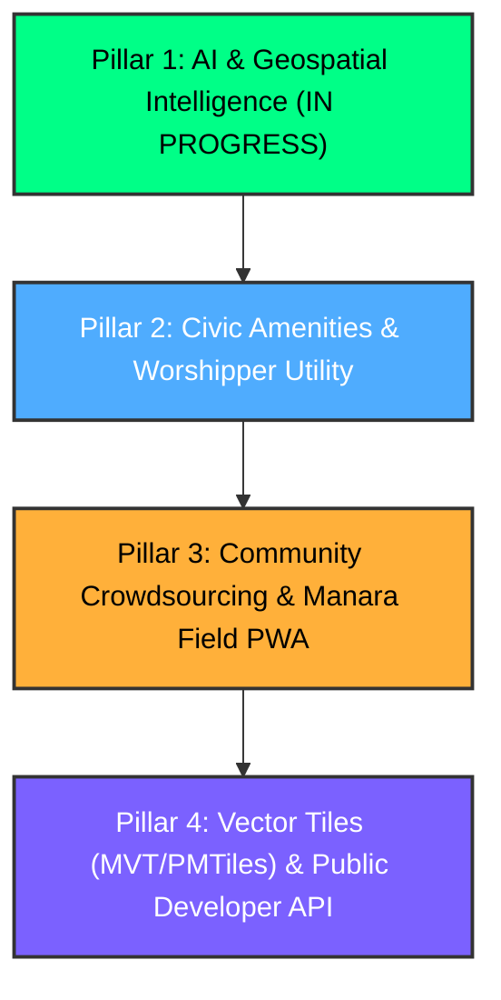

# Manara: Strategic Next-Level Roadmap
### Pillars 2, 3, and 4 — Expansion, Civic Impact & Technical Scaling

This document outlines the strategic blueprint to take **Manara** (`manara.saudiosm.org`) beyond quality assurance into the definitive civic, community, and geospatial intelligence platform for places of worship in Saudi Arabia and the GCC region.

---

## 🏛️ Pillar 2: Civic Impact & Real-World Worshipper Utility

While Manara began as an OpenStreetMap mapper's quality-assurance dashboard, its underlying geospatial datasets hold immense practical value for citizens, residents, pilgrims, researchers, and charitable foundations.

### 2.1 Worshipper Amenities & Inclusivity Mapping
Currently, places of worship in the database primarily track basic tags (`name`, `religion`, `building`, `amenity`). Expanding tag extraction and UI visualization to key practical amenities will make Manara directly useful to everyday worshippers:

1. **Women's Prayer Facilities (`female=yes/no/dedicated`, `female:access=*`):**
   - High demand across Saudi Arabia from families and travelers.
   - Highlights whether a mosque has a dedicated women's prayer hall, second-floor gallery, or separate entrance.
2. **Wheelchair & Physical Accessibility (`wheelchair=yes/no/limited`, `toilets:wheelchair=*`):**
   - Ramped access to prayer halls.
   - Accessible ablution (*wudu*) and restroom facilities for elderly and disabled worshippers.
3. **Congregational & Funeral Prayer Capabilities:**
   - **Friday Congregational Prayers:** `place_of_worship=jamea` vs `place_of_worship=mosque`.
   - **Funeral Prayers (*Salat al-Janaza*):** `funeral_services=yes` or `service:funeral=yes` (marking major central mosques equipped with mortuary and funeral facilities).
   - **Eid Prayer Grounds:** `worship:eid=yes` / `amenity=place_of_worship` + `place_of_worship=musalla`.
4. **Transit & Highway Mosques:**
   - Distinguishing highway rest-stop mosques (`highway=services` / `amenity=fuel`) with 24/7 restrooms, EV charging, and travel accommodations along major intercity corridors (e.g., Riyadh–Makkah, Riyadh–Dammam, Madinah Highway).

### 2.2 The "Mosque Need Index" (مؤشر الاحتياج المكاني للمساجد)
Philanthropic donors, endowments (*Awqaf*), and charitable platforms (such as the **Ehsan Platform - منصة إحسان**) frequently seek data-driven spatial justification before funding or constructing new mosques.

* **Methodology:**
  - Aggregate high-priority residential gap cells by administrative hierarchy (Region ➔ Governorate ➔ Municipality / District / Neighborhood).
  - Compute a composite **Worship Need Index (WNI)** incorporating population density proxies, pedestrian network connectivity (400m walk sheds), and existing capacity.
* **Deliverable:**
  - Public & downloadable spatial analytical reports: *"Top 10 Districts Most in Need of Mosques in Riyadh / Jeddah / Dammam"*.
  - Exportable executive summaries for charitable organizations and municipal urban planners.

### 2.3 Cultural Heritage & Historic Mosques
Saudi Arabia possesses profound Islamic architectural heritage, highlighted by national initiatives like the **Prince Mohammed bin Salman Project for Historical Mosques Development (مشروع الأمير محمد بن سلمان لتطوير المساجد التاريخية)**.
- Tag and showcase registered historical mosques (`historic=yes`, `heritage=*`, `start_date=*`).
- Create dedicated heritage badges and filter modes on the map with historical background summaries and architectural styles (e.g., Najdi, Hejazi, Asiri, Eastern Arabian).

---

## 👥 Pillar 3: Community Crowdsourcing & Gamification

Engaging the broader Saudi mapping community and local residents transforms data maintenance from a periodic task into a vibrant, self-sustaining community effort.

### 3.1 "Manara Field" — Mobile-First Progressive Web App (PWA)
A dedicated mobile field-mapping interface allowing users visiting a mosque to contribute on the spot:
- **Instant Geolocation:** Automatically locates the user's current position within a mosque.
- **Micro-Verification Checklist:**
  - [ ] Confirm official mosque name from external plaque.
  - [ ] Does it host Friday congregational prayers (*Jamea*)?
  - [ ] Is there an accessible wheelchair entrance?
  - [ ] Is there a women's prayer area?
- **Seamless OSM Sync:** One-tap submission via the logged-in Manara OAuth session with changeset tag `#sa-worship-map`.

### 3.2 Automated MapRoulette Micro-Campaigns
Turn large data-improvement backlogs into focused, bite-sized tasks:
- Periodically publish themed **MapRoulette Challenges**:
  - *"Verify 100 Unaligned Qibla Outlines in Makkah Region"*
  - *"Add English Names to Grand Mosques in Eastern Province"*
  - *"Convert 50 Isolated POI Nodes into Building Outlines"*
- Direct deep-links from Manara into MapRoulette tasks.

### 3.3 Community Telegram & Social Automation
- **Weekly Mapping Digest:** Automated weekly Telegram/X post highlighting:
  - Total mosques added or updated during the week.
  - Top 3 contributors on the Manara Community Leaderboard.
  - Neighborhood of the week (highest improvement velocity).
- **Mapper Alerts:** Optional opt-in notifications when another mapper verifies or notes an issue in a user's monitored region.

---

## ⚡ Pillar 4: Architecture & Technical Scaling

As Manara's dataset expands (with over 14,000 places, 54,000 Wikidata suggestions, and 60,000 gap cells), client-side GeoJSON loading reaches performance bottlenecks. The following architectural evolutions ensure smooth performance across all devices.

### 4.1 Vector Tiles Architecture (MVT & PMTiles)
* **The Challenge:** The browser currently downloads static GeoJSON files (e.g. 1.1 MB Brotli / 11 MB uncompressed for Wikidata suggestions; ~7.5 MB for places). On mobile devices or low-bandwidth connections, parsing large JSON arrays in JavaScript can cause brief UI stutters.
* **The Solution:**
  1. **Dynamic MVT Endpoints via PostGIS:**
     - Expose `GET /api/v1/tiles/{layer}/{z}/{x}/{y}.pbf` using PostGIS `ST_AsMVT` and `ST_TileEnvelope`.
     - Fast, memory-efficient spatial slicing directly from database GiST indexes.
  2. **Static PMTiles for Serverless Edge Serving:**
     - Generate single-file `places.pmtiles` and `gaps.pmtiles` during the daily pipeline runner.
     - Serve vector tiles directly via HTTP Range Requests through Caddy with near-zero VPS memory consumption.
  3. **Leaflet Vector Tile Renderer:**
     - Use MapLibre GL or Leaflet.VectorGrid for hardware-accelerated 60fps rendering, smooth zoom transitions, and instant styling.

### 4.2 Dynamic Viewport Suggestions Streaming
* Instead of buffering all 54,504 Wikidata suggestions in client memory, leverage the existing PostGIS bounding-box endpoint:
  `GET /api/v1/suggestions?bbox=minLon,minLat,maxLon,maxLat&limit=250`
* Load suggestions dynamically on `map.on('moveend')` when zoom level $\ge 13$.

### 4.3 Public Developer API & Embeddable Widget
* **Open Developer API:**
  - Provide authenticated/rate-limited endpoints for regional Islamic software developers (e.g., Athan apps, prayer times tools, Islamic navigation apps):
    - `GET /api/v1/places/nearby?lat=24.71&lon=46.67&radius_m=1000&amenities=female,wheelchair`
    - `GET /api/v1/places/{osm_type}/{osm_id}/qibla`
* **Embeddable Manara Map Widget:**
  - A lightweight, responsive `<iframe>` or standalone JS component that non-profits, governmental portals, or community blogs can embed to show places of worship in specific neighborhoods or cities.

---

## 📅 Suggested Implementation Sequencing

1. **Step 1:** Complete Pillar 1 (Transliteration NLP, Smart Gap Urgency Ranking, Mosque Classification).
2. **Step 2:** Integrate Mosque Amenities (female prayer spaces, wheelchair access, funeral prayer indicators) into the pipeline and UI (Pillar 2).
3. **Step 3:** Deploy the "Manara Field" PWA / mobile quick verification tool (Pillar 3).
4. **Step 4:** Transition heavy layers to Vector Tiles (PMTiles / MVT) for lightning-fast performance (Pillar 4).

