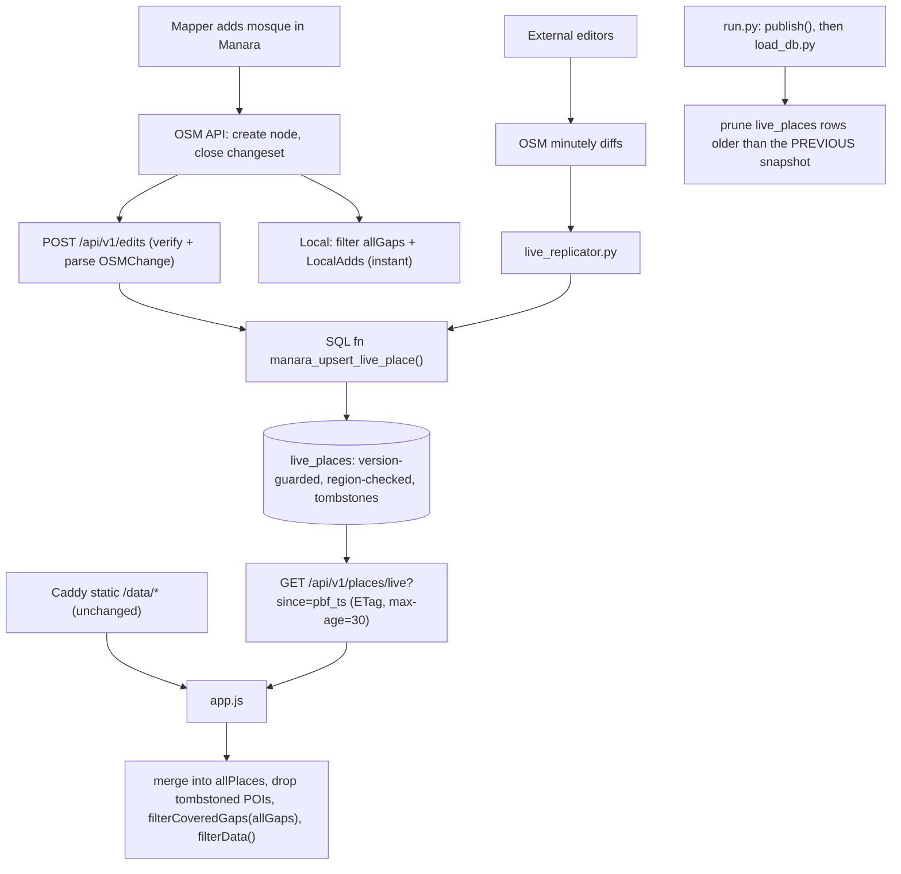

# Live Coverage-Gap & Mosque Updates Plan (v2)

## 0. What changed from v1

v1 was checked against the code (2026-11-25). Main corrections and additions:

| # | v1 assumption | Reality / improvement |
|---|---|---|
| 1 | Switching on `sync_live_places=True` is enough for the replicator. | The existing branch (`live_replicator.py:333-347`) has three bugs: **(a)** when a `modify` strips the worship tags it does nothing, so the row is never deleted. **(b)** `region_code` comes only from `known_places`, so it is always `NULL` for new places. **(c)** It has no version guard. All three need fixing, not just checking. |
| 2 | The SA bbox filter keeps edits from other countries out. | `SA_BBOX (34.5,16.0,55.7,32.2)` also covers **Qatar, Bahrain, Kuwait, most of the UAE, and parts of Jordan, Iraq and Yemen**. A mosque added in Doha would show on the map and could clear gap cells near the border. Rows must be checked against the `regions` polygons; a row with no region is rejected. |
| 3 | Pruning by "same version" or `poi_node_id` match. | Two different SQL rules, both fragile, and the `OR` join in the API can't use an index. Replaced with **one rule based on the OSM timestamp, kept one snapshot behind** (§4 Phase 2), plus a `?since=` filter on the API. |
| 4 | Change `allGaps` and `filteredGaps` separately. | `filterData()` (`app.js:2262`) already rebuilds `filteredGaps` from `allGaps` and applies the urgency filter. Changing both by hand risks a `filteredGaps` that ignores the high-urgency filter. **Change `allGaps` only, then call `filterData()`.** |
| 5 | Cell centre is "within ~220 m" of the point the pipeline measures from. | A cell is 0.004° (≈407 × 445 m at 24°N), so half its diagonal is **≈300 m**. Using the centre wrongly clears or keeps a real band of cells. Fix: publish the road-weighted point's offset inside the cell (§4 Phase 4.0). |
| 6 | Other users see the change "in seconds". | Only after a **page reload**. Added a cheap refresh when the tab becomes visible and every 5 minutes, using ETag/304. |
| 7 | Deleting a mosque that is already in the snapshot waits for the daily build. | Still true for **gaps**: cells within 750 m are not in the static file, so they can't be brought back on the client. The **POI marker**, though, can be hidden at once using a tombstone row. Added as an option. |
| 8 | Ways: "handled by the replicator". | The replicator can place a way only if its nodes are in the same diff. Tagging an **existing** building as a mosque (common in iD) gets no position and is dropped (`pending` isn't passed in `run_replication_step`). This is listed as a known limitation; an optional fix is in Phase 5. |
| 9 | — | `edits.py` and the replicator would write the same table with different code. Both now use **one SQL function** (`manara_upsert_live_place`), so the version guard, region lookup and tombstone logic exist in one place for both containers. |
| 10 | — | Added rollout order, feature flags, observability, and an abuse cap. |

---

## 1. Problem & Goal

When a mapper adds a mosque node in Manara, it is uploaded to OSM and added to that mapper's in-memory `allPlaces`. However:
- The coverage gap layer (`worship_gaps_sa.json`) does not update for anyone until the next daily Geofabrik build (`run.py` → `publish()` → `load_db.py`). That is about 12–24 h.
- Other users don't see the new mosque until that same build.

### Goal
New mosques should clear gap cells within **750 m** (`calculate_gaps.py` `MIN_GAP_DISTANCE_M`) and appear on the map for everyone:

| Source | Uploader | Other users |
|---|---|---|
| Manara "Add mosque" | instant (0 s) | ≤ 5 min with the tab open, or on the next load |
| External editors (iD, JOSM, StreetComplete, Every Door) | — | ~1–2 min (replication lag), then shown on the next refresh |

Constraints:
- No change to Caddy's pre-compressed static serving of `/data/*`.
- OSM usage policy (see the OSM compliance memory): no bulk OSM API reads. The minutely diffs are the only live feed. The one OSM API call per Manara edit that `edits.py` already makes is fine.
- Static deployments with no backend must keep working.

### Non-goals
- Recomputing `gap_score` / `urgency_score` for cells 750–3000 m from a new mosque. Their scores stay too high until the daily build. Only covered cells are removed.
- Bringing gaps back on the client when a mosque from the snapshot is deleted.
- Updating server-side gap counts (`/api/v1/stats`, `meta`, `seo` region pages, sprint tile workload) and `gaps.pmtiles` (the `/mapgl` page). These stay daily.

---

## 2. Current State Audit (verified)

| Component | Current behaviour | Gap |
|---|---|---|
| `backend/app/schema.py:136` | `live_places (osm_type, osm_id, version, geom, region_code, tags, seen_at)`. `live_pending` exists too. | Nothing reads or writes either table in production. No tombstone, OSM-timestamp or source columns. |
| `backend/app/routers/edits.py` | `POST /api/v1/edits` checks ownership, closed state and hashtag, downloads OSMChange (2 MiB cap), and `parse_osmchange_objects` keeps only `(type,id)`. | Coordinates, tags, action and timestamp are thrown away. Nothing writes `live_places`. |
| `frontend/src/osm_api.js:480` `addNode()` | Opens, creates, closes, then **awaits** `reportEdit()` before returning. | Good: the backend write finishes before the UI shows success. `reportEdit` ignores errors, so the replicator is the fallback. |
| `pipeline/live_replicator.py:415` | `record_live_events(...)` without `sync_live_places`. | See §0 rows 1, 2 and 8. Its `known_places` cache is loaded once at start and never reloaded after a daily swap (existing issue; deletions of mosques new in the daily data aren't recognised until a restart). |
| `pipeline/load_db.py:521-542` | Swaps `places`/`gaps`/… atomically. `dataset_versions.pbf_timestamp` is available. | `live_places` is never pruned. |
| `pipeline/run.py:388-390` | `publish()` (static files) **then** `load_db.py`. | For a short window, clients have new static files while the DB still has the old snapshot. That's harmless with the `since` design below. |
| `backend/app/routers/places.py` | Only `GET /places/{type}/{id}`. | No live endpoint. (`/places/live` doesn't clash: it has a different number of path segments.) |
| `frontend/src/app.js` | `initializeDashboard()` (1571) parses gaps with `parseGapGrid` (1706): cell **centre** plus positional fields. `submitPendingMosqueNode()` (3580) adds to `allPlaces`/`filteredPlaces` only. | No live fetch, no gap filtering, no redraw. |
| `frontend/public/sw.js:38-57` | `/api/*` is network-first and caches `200` responses in `CACHE_NAME`. | Pass `/api/v1/places/live` through network-only without caching, and add a test. |
| `frontend/src/editing.js` `LocalPatches` | Per-browser tag patches, pruned by `pbf_timestamp`. | The same pattern can keep the uploader's new mosque across reloads when the backend is unreachable. |

---

## 3. Architecture



Why only a delta: the gap file is several MB and is served pre-compressed by Caddy. The live delta is a few KB and changes every minute, so it goes through FastAPI. The client applies it.

---

## 4. Implementation Plan

### Phase 1 — Schema & shared write path

#### 1.1 Migration `backend/migrations/004_live_places_v2.sql`
- Add columns:
  - `osm_timestamp TIMESTAMPTZ`: the element's `timestamp` attribute, from both the OSMChange download and the minutely diffs. Pruning and `since` use this, not `seen_at`.
  - `deleted BOOLEAN NOT NULL DEFAULT FALSE`: tombstone.
  - `source TEXT NOT NULL DEFAULT 'replication'`: `'manara'` or `'replication'`.
  - `changeset_id BIGINT`.
- Indexes: `(osm_timestamp)`, plus `places (poi_node_id)` if it doesn't exist yet (used by the anti-join). Guard the `places` index in `004` with `to_regclass('public.places') IS NOT NULL` (so fresh DBs don't fail before `load_db.py` runs), and also add `idx_places_poi_node_id` to `pipeline/load_db.py:init_db` so daily table swaps preserve it.
- Keep storing no `user`/`uid`, the same rule as `parse_osc_stream`.

#### 1.2 SQL function `manara_upsert_live_place(osm_type, osm_id, version, lon, lat, tags, deleted, osm_ts, source, changeset_id)`
Defined in the same migration. **This is the only write path**, used by both `edits.py` and the replicator (they run in separate containers, so a shared Python module isn't an option).
- **Region check:** `region_code := (SELECT code FROM regions WHERE ST_Intersects(geom, pt) LIMIT 1)`. If it is `NULL` and the place is not a tombstone, return without writing. This handles the bbox spill-over in §0 row 2.
- **Version guard:** `ON CONFLICT (osm_type, osm_id) DO UPDATE … WHERE live_places.version IS NULL OR EXCLUDED.version >= live_places.version`. This avoids a stale write when `edits.py` (v2) arrives before the replicator processes v1.
- **Deletes and tag removal** are written as tombstones (`deleted = TRUE`, geom kept from the existing row or from the `places` lookup). They are not `DELETE`d, so the version guard keeps working, and the client can hide snapshot POIs (§0 row 7).
- Tombstones are only written for objects that exist in `places` or `live_places`. Deletions of objects we don't know about are ignored.

#### 1.3 Worship predicate parity
Copy the 3-line `is_worship_tagged()` from `pipeline/worship_tags.py` into `backend/app/worship_tags.py`. Add a parity test that imports both and checks them on a shared table of tag sets.

---

### Phase 2 — Writers

#### 2.1 `backend/app/routers/edits.py`
- Add a separate helper (e.g., `parse_osmchange_live`) alongside `parse_osmchange_objects` (keeping `parse_osmchange_objects`'s return type unchanged) to extract `live_changes`: for each `node` in `create`/`modify`/`delete`, read `id`, `version`, `lat`, `lon`, `timestamp` and tags.
  - Worship-tagged `create`/`modify` → upsert.
  - `modify` without worship tags, or `delete` → tombstone (the function skips objects it doesn't know).
  - Ways and relations: skip in v1 (no coordinates in OSMChange). The replicator covers new ways; see Phase 5 for tagging existing buildings.
- Call `manara_upsert_live_place` inside the existing transaction (lines 229–241), `source='manara'`.
- **Idempotent replay:** the "already recorded" early return (line 132) skips the live write. That's fine because the first call did it in the same transaction. Don't add the live write to the replay path.
- **Abuse cap:** at most 50 live upserts per changeset; log anything above that. One fake bulk changeset should not wipe out gaps nationwide before it is reverted.

#### 2.2 `pipeline/live_replicator.py`
- Behind env flag `MANARA_LIVE_PLACES_SYNC=1` (default off until Phase 6), pass `sync_live_places=True` at line 415.
- Replace the inline INSERT/DELETE (333–347) with calls to `manara_upsert_live_place`:
  - `created`/`modified` + worship-tagged + has coordinates → upsert.
  - `modified` without worship tags, or `deleted` → tombstone. **This fixes bug 1a.**
  - Pass the element `timestamp`. `parse_osc_stream` must read `elem.attrib["timestamp"]`; today it isn't extracted.
- `source='replication'`. It will see the same change that `edits.py` already wrote about 1–2 min later. The version guard makes that a no-op apart from `seen_at`.
- Filter `load_known_places` on `live_places` with `AND NOT COALESCE(deleted, FALSE)` so tombstone rows aren't loaded as active places on restart.
- Reload the cache: every 10 min, check `SELECT version FROM dataset_versions ORDER BY published_at DESC LIMIT 1`. If it changed, reload `known_places`. This fixes the existing stale-cache issue after a daily swap.

---

### Phase 3 — Prune on daily rollover (`pipeline/load_db.py`)

Rule: **keep live rows for one extra snapshot.**

```sql
-- inside the swap transaction, after places/gaps are renamed in
DELETE FROM live_places
WHERE osm_timestamp IS NOT NULL
  AND osm_timestamp < (
    SELECT pbf_timestamp FROM dataset_versions
    WHERE pbf_timestamp IS NOT NULL
    ORDER BY pbf_timestamp DESC OFFSET 1 LIMIT 1   -- previous snapshot
  );
```

Why this is better than v1's version and `poi_node_id` rules:
- One rule covers every case: absorbed into `places`, merged into a building's `poi_node_id`, deliberately dropped by the pipeline, deleted then pruned. Anything older than the snapshot is already reflected in it, one way or another.
- A one-snapshot lag means a client that still has yesterday's static files (cache, or the `publish()`→`load_db` window) still receives the rows it needs through `?since=`.
- The table stays small (≈1–2 days of edits).
- Guard with `to_regclass('public.live_places') IS NOT NULL`. If `pbf_timestamp` is NULL (older summaries), skip pruning that run.

---

### Phase 4 — Read path

#### 4.0 Exact gap coverage: publish the road-weighted point (`calculate_gaps.py`)
- Add two fields to each cell, `rx` and `ry` = round(99 × (rep − cell_origin) / GRID_SIZE), integers 0–99. Update `fields` to `[…, "urgency_score", "rx", "ry"]`.
- `parseGapGrid` uses `rx`/`ry` when present, otherwise the cell centre. Old files keep working. Store `rep_lat`/`rep_lon` on each cell object; viewport counts keep using `lat`/`lon`.
- Check that the other positional readers (`load_db.py:285`, `build_data_hub.py`, `build_overlays.py`) index into cells and don't unpack them strictly.
- Cost: about 6 bytes per cell before compression. Measure the brotli size change in the PR. If it's unacceptable, use a fallback: only clear cells whose **centre** is within 750 − 300 = 450 m. That never clears a real gap, but leaves some covered cells until the daily build.

#### 4.1 `GET /api/v1/places/live?since=<ISO pbf_timestamp>` (`backend/app/routers/places.py`)
```sql
SELECT lp.osm_type, lp.osm_id, lp.version, lp.deleted,
       ST_X(lp.geom) AS lon, ST_Y(lp.geom) AS lat,
       lp.region_code, lp.tags, lp.osm_timestamp
FROM live_places lp
WHERE lp.geom IS NOT NULL
  AND lp.osm_timestamp > %(since)s
  AND (lp.deleted OR (                           -- hide objects already in the snapshot
        NOT EXISTS (
          SELECT 1 FROM places p
          WHERE p.osm_type = lp.osm_type AND p.osm_id = lp.osm_id)
        AND NOT (lp.osm_type = 'node' AND EXISTS (
          SELECT 1 FROM places p
          WHERE p.poi_node_id = lp.osm_id))))
ORDER BY lp.osm_timestamp DESC
LIMIT 2000;
```
- If `since` is missing or doesn't parse, use the newest `dataset_versions.pbf_timestamp`.
- Response: `{ type: "FeatureCollection", features: [...], removed: [{osm_type, osm_id}], generated_at }`. Features have the same property shape that `submitPendingMosqueNode` builds (`osm_id`, `osm_type`, `geom_type:'Point'`, `name`, `name_en`, `name_ar`, `religion`, `denomination`, `building`, `amenity`, `wheelchair`, `female`, `capacity`, `wikidata`, `version`, `edited_at`, `_live: true`). Extract **one** `tagsToPlaceProps()` mapping and use it in both places, so the two shapes can't drift apart.
- Caching: `ETag` = hash of `(count, COALESCE(max(seen_at)::text, ''), since)`, and return `304` on `If-None-Match`. Header `Cache-Control: public, max-age=30`.
- `@limiter.limit("120/minute")`. If the `LIMIT` is reached, log a warning (it means pruning or abuse went wrong).

#### 4.2 `frontend/src/gap_field.js`: `filterCoveredGaps(cells, points, radiusM = 750)`
- Distance metric: `dx = Δlon·111320·cos(rep_lat)`, `dy = Δlat·110574` (`M_PER_DEG_LAT = 110574` from `pipeline/common.py`), squared comparison, measured from `rep_lat`/`rep_lon` (from 4.0). Note: `calculate_gaps.py` currently projects each point with its own `cos(lat)` instead of `Δlon·cos(rep_lat)`, which introduces a ~150–260 m skew across Δlat; align `calculate_gaps.py` or validate the golden parity test against the `Δlon·cos(rep_lat)` formula.
- Search only nearby cells: for each point, look only at `gx ± 3`, `gy ± 3` via a `Map("gx,gy" → index)` (750 m ≈ 1.9 cells, plus 1 for the rep offset). That's O(points × 49), not O(cells × points). Return a new array and don't modify the input.
- Export `GAP_COVERAGE_RADIUS_M = 750` with a comment pointing to `calculate_gaps.py`.

#### 4.3 `frontend/src/app.js`
- Keep `staticGaps` immutable after `parseGapGrid(gapData)` so live-added mosques whose deletion later arrives via refresh restore their gap cells without a reload.
- **`applyLiveDelta(delta)`**, a single entry point used by every path below:
  1. For each `removed` entry: drop it from `allPlaces`/`filteredPlaces` (using `osmTypeOf(f.properties)`).
  2. For each feature: if `${osm_type}/${osm_id}` is already in `allPlaces` (checked via `osmTypeOf(f.properties)`), skip it (the static or local copy wins). Otherwise push it.
  3. Recompute `allGaps = filterCoveredGaps(staticGaps, activeLivePoints)` from all active live + `LocalAdds` points.
  4. `filterData()`. That rebuilds `filteredGaps` with the urgency filter, rebuilds `markerClusterLayer`, redraws, and updates stats.
- **Initial load:** after `initializeDashboard()`, fetch `/api/v1/places/live?since=${dataSummary.pbf_timestamp}` without blocking first paint (`.catch(() => null)`). Static and preview builds just get a 404 and continue.
- **Refresh while open:** refetch on `visibilitychange → visible` and every 5 min while visible, using `If-None-Match`. This is what makes "other users" work without a reload.
- **Upload (`submitPendingMosqueNode`):** after the existing `allPlaces.push(...)`, call `applyLiveDelta({features:[newFeature], removed:[]})` in place of the separate `updateDashboardUI()` gap logic.
- **Keep the uploader's mosque across reloads:** store `{nodeId, lat, lon, tags, uploadedAt}` in a small `LocalAdds` store (same pattern as `LocalPatches`, pruned by `pbf_timestamp`) and replay it through `applyLiveDelta` on load. Then the uploader still sees the mosque after a reload even if `reportEdit` failed or the backend is down.

---

### Phase 5 — Optional: existing buildings tagged as mosques

The gap: a way with no nodes in the diff can't be placed (§0 row 8).
- **Manara edits:** for a `modify` of a way/relation that is worship-tagged and not in `places`, `edits.py` makes **one** `GET /api/0.6/way/{id}/full` (user-triggered, one object; within the OSM API policy) and computes the centroid.
- **External edits:** pass `pending` in `run_replication_step` so these go to `live_pending`. Placing them needs node locations we don't have without bulk reads, so they stay daily-only. Document this rather than adding Overpass calls.

---

### Phase 6 — Rollout & observability

1. Deploy migration 004 and the endpoint (returns empty). Deploy the frontend, which does nothing with empty results.
2. Turn on the `edits.py` writes. Watch rows with `source='manara'`.
3. Set `MANARA_LIVE_PLACES_SYNC=1` on the replicator container.
4. Run one daily cycle and check that pruning only removed rows older than the previous snapshot.
5. Add `live_places: {count, tombstones, oldest_osm_timestamp}` to `/api/v1/meta` (or healthz). If the oldest row is older than 3 days, pruning is broken.

The VPS RAM caps (see the hosting memory) aren't affected: the table holds hundreds of rows, and the replicator cache grows by the same amount.

---

## 5. Edge Cases

1. **Cells 750–3000 m away** keep their old score and urgency until the daily build (non-goal).
2. **Deleting a mosque that is in the snapshot:** the POI is hidden through a tombstone. Its covered gaps come back only after the daily build.
3. **Moving a live mosque:** the upsert updates its position. On the client, gaps already cleared at the old spot stay cleared until a reload. On reload, cells are filtered from the fresh static file against the current position, so this is correct.
4. **Race between `edits.py` and the replicator:** handled by the version guard and tombstones.
5. **Edits outside SA but inside the bbox:** rejected by the region check in the SQL function.
6. **Vandalism through external editors:** appears in about 2 minutes and is undone just as fast once reverted. That's the same trust model as the daily build, only quicker. The per-changeset cap (2.1) applies only to Manara uploads. For the replicator, log changesets with more than 50 worship creates (this fits the existing change-events flags).
7. **Static / offline deployments:** every live call is best-effort. `LocalAdds` still gives the uploader their own mosques.
8. **Service worker:** `/api/*` is network-first (`sw.js:38`), but currently caches `200` responses in `CACHE_NAME`. Pass `/api/v1/places/live` through network-only without caching so stale live deltas are never served offline (`LocalAdds` already covers the uploader).

---

## 6. Testing

**Backend (pytest)**
- OSMChange parser: worship node created; non-worship node ignored; tags stripped → tombstone; delete of an unknown object ignored; `timestamp` extracted.
- SQL function (integration, PostGIS fixture): point in Bahrain rejected; older version doesn't overwrite newer; tombstone then a stale create → stays a tombstone; `region_code` filled in.
- `POST /edits` writes `source='manara'` rows; replaying it doesn't write twice; changeset over the cap is truncated and logged.
- `GET /places/live`: `since` filter; snapshot anti-join (by id and by `poi_node_id`); `removed` list; ETag → 304.
- `is_worship_tagged` parity test between backend and pipeline.

**Pipeline (pytest)**
- Replicator with the sync flag on: create → row; modify stripping tags → tombstone; delete → tombstone; way centroid from the diff.
- `load_db` pruning: rows older than the previous snapshot removed, newer rows kept; no-op when `pbf_timestamp` is NULL; no error on a fresh DB.
- `calculate_gaps` writes `rx`/`ry` that rebuild the representative point to within 1/99 of a cell.

**Frontend (vitest + eslint + vite build)**
- `filterCoveredGaps`: 749 m removed, 751 m kept (both at 17°N and 32°N, to check the cosine scaling); empty points do nothing; input array not modified.
- **Golden parity test:** a fixture of about 50 cells and 5 mosques, with the expected kept set produced by the Python `Δlon·111320·cos(rep_lat)` / `Δlat·110574` distance code (or aligned `calculate_gaps.py` projection). The JS result must match exactly.
- `parseGapGrid` handles both old (5-field) and new (7-field) files.
- `applyLiveDelta`: skips duplicates, removes tombstoned POIs, respects the high-urgency filter after `filterData()`.
- `sw.js` never caches `/api/v1/places/live`.

**Manual end-to-end**
1. In gap mode, add a mosque over a gap cell. The gap disappears at once.
2. Open a second browser that's already on the page. Switch tabs and back: the mosque and the cleared gap appear without a reload.
3. Add a mosque with iD near a gap. It shows within about 2 minutes plus the refresh interval.
4. Delete it in iD. After a refresh its marker is gone and the gap is back (it was live-added, so the gap cell is still in the static file).
5. After the next daily build, the rows are absorbed and later pruned, and the map looks the same.
